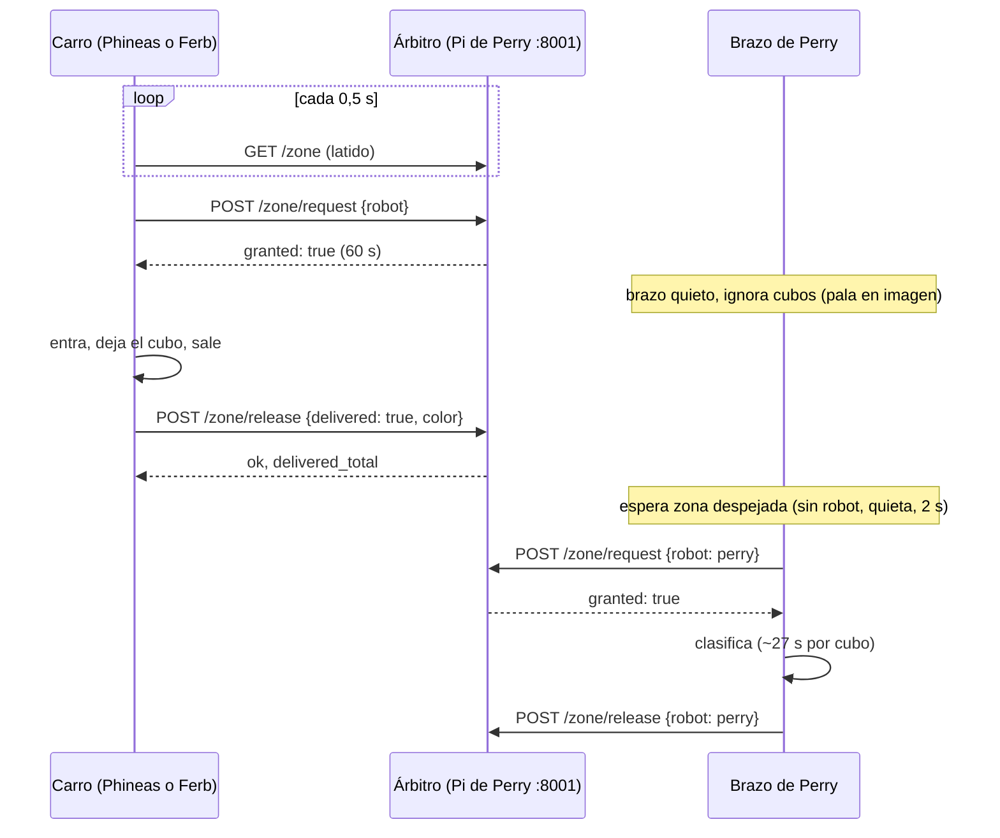

# Comunicación entre Perry, Phineas y Ferb: propuesta

| | |
| --- | --- |
| Estado | **Propuesta**, para discutir con los equipos de Phineas, Ferb y con Cristian (comunicación de Perry) |
| Fecha | 31-10-2026 |
| Autores | Equipo de Perry (brazo) |
| Relacionado | [Estados de Perry frente a la zona](perry_zona_estados.md) · contrato `multirobot_interfaces` de [ucab-multirobot](https://github.com/alejandrovielma/ucab-multirobot) |

## 1. Resumen

Proponemos **mantener el contrato que ya acordaron Phineas y Ferb** (llave de la zona con préstamo de 60 s,
devolución con el color entregado, conteo oficial y latido que frena a los carros), pero transportarlo
por **HTTP con JSON desde la Pi de Perry**, en lugar de ROS 2.

Cambia el medio, no el significado. Si más adelante se instala ROS 2, un puente traduce uno a otro sin
tocar la lógica de nadie.

## 2. Por qué

Lo que vimos el 31-10 en los repositorios (`ucab-multirobot` en `main`, `Ferb-Recolector` en `develop`):

| | Contrato escrito | Lo que corre hoy en el laboratorio |
| --- | --- | --- |
| Phineas | ROS 2 Lyrical, `/zone/*` | `tools/lab/lab_robot.py`, sin ROS, sin árbitro |
| Ferb | Nodo `fleet_link` con `zone/want` y `zone/granted` | `tools/teleop_web.py`, sin ROS, sin árbitro |
| Perry | Árbitro en ROS (rama `mejoras-de-portabilidad`, con Docker) | Panel web (`audit_web.py`), sin ROS |

- **ROS 2 no está instalado en ninguna Pi.** En la de Perry (Debian 13) solo entraría con Docker, y la Pi
  no tiene internet para bajar la imagen.
- **La lógica de Phineas ya es independiente del transporte**: su `BehaviorFSM` devuelve acciones
  «pedir llave» y «devolver llave» (`take_actions()` → `ZoneAction`) y recibe como dato si tiene la llave
  (`holds_zone`). Conectarla a HTTP es un adaptador chico.
- **Ferb** ya tiene los ganchos `zone/want`, `zone/granted` y `zone/delivered` en su máquina de estados.
- HTTP no necesita nada nuevo en ninguna Pi: Python ya trae todo (`urllib`, `http.server`).

## 3. La propuesta

### 3.1 Quién hace qué

- **Perry** corre el **árbitro de la zona**: un proceso propio, **separado del brazo**, en el puerto
  **8001** de su Pi. El panel del brazo sigue en el 8000.
- **Phineas, Ferb y el brazo de Perry** son clientes del árbitro y piden la misma llave.
  Nombres: `"phineas"`, `"ferb"`, `"perry"`.
- La **hora de referencia es la del árbitro**: los préstamos se cuentan en el reloj de Perry. Los carros
  solo miden cuánto hace que no reciben respuesta, con su propio reloj, así que no hace falta sincronizar
  relojes entre las Pi.

### 3.2 Las tres operaciones

Todas en `http://<IP-de-Perry>:8001`, con cuerpo y respuesta JSON.

#### `GET /zone`: estado de la zona (es también el latido)

```json
{
  "occupant": "phineas",
  "lease_left_s": 41.5,
  "closed": false,
  "reason": "",
  "colors": ["blue", "yellow"],
  "delivered_total": {"phineas": 3, "ferb": 2},
  "perry_state": "CARRO_EN_ZONA"
}
```

| Campo | Significado |
| --- | --- |
| `occupant` | Quién tiene la llave: `""` (libre), `"phineas"`, `"ferb"` o `"perry"` |
| `lease_left_s` | Segundos que le quedan al préstamo actual (0 si está libre) |
| `closed` | `true`: **dejen de traer cubos** (zona llena, trabada o Perry en falla) |
| `reason` | Por qué está cerrada: `"full"`, `"blocked"`, `"fault"`, `"operator"` |
| `colors` | **Colores que Perry pide que traigan.** Por defecto `["blue", "yellow"]` |
| `delivered_total` | Conteo oficial de entregas por robot |
| `perry_state` | Estado de Perry, solo informativo ([estados](perry_zona_estados.md)) |

Nombres de colores en inglés, como en el código de los carros: `blue`, `yellow`, `green`, `orange`,
`purple`, `red`.

#### `POST /zone/request`: pedir la llave

```json
{"robot": "phineas"}
```

Respuesta (los mismos campos que `RequestZone.srv`):

```json
{"granted": true, "holder": "phineas", "lease_seconds": 60.0}
```

- Si la zona está libre y abierta, se otorga por `lease_seconds` (60 s).
- **Si el mismo robot la vuelve a pedir mientras la tiene, se renueva.**
- Si la tiene otro, o está cerrada: `granted: false` y `holder` dice quién la tiene. Si está cerrada,
  `holder` es `"perry"`.

#### `POST /zone/release`: devolver la llave

```json
{"robot": "phineas", "delivered": true, "color": "blue"}
```

Respuesta (los mismos campos que `ReleaseZone.srv`):

```json
{"ok": true, "delivered_total": 4}
```

- Con `delivered: true` se suma una entrega al conteo oficial de ese robot.
- Si la devuelve alguien que no la tiene: `ok: false`, y el conteo no cambia.
- `delivered: false`: el cubo se cayó o se perdió en el camino. Se devuelve la llave sin contar.

Errores: un `robot` desconocido o un JSON mal formado devuelven HTTP 400 con `{"error": "..."}`.

### 3.3 Reglas de seguridad (las mismas del contrato)

1. **Latido:** cada carro consulta `GET /zone` **cada 0,5 s**. Si pasan **2,0 s sin una respuesta
   válida**, el carro **frena** (no avanza; puede girar en el lugar). Es la misma regla que el contrato
   ROS: si Perry se cae, los carros paran solos.
2. **Sin llave no se entra.** Un carro espera a más de 30 cm del cuadro hasta tener `granted: true`, o
   hasta que `occupant` sea su nombre.
3. **Zona cerrada:** con `closed: true`, el carro no pide la llave y **sigue con su exploración sin
   entregar**, o espera afuera.
4. **Colores:** el carro solo recoge los colores de `colors`. Si cambian mientras lleva un cubo de un
   color que ya no está en la lista, lo entrega igual (Perry decide qué hacer con él).
5. **Desempate:** si los dos carros esperan, el árbitro otorga la llave en el orden en que la pidieron.
   El contrato dice que **Ferb cede**; eso queda para los choques en la pista, no para la llave.

### 3.4 Secuencia de una entrega



### 3.5 Cómo se conecta cada carro

**Phineas** (`lab_robot.py`): su `BehaviorFSM` ya produce las acciones y consume `holds_zone`. Alcanza con
un adaptador que en cada vuelta del lazo:

```python
import json, time, urllib.request

PERRY = "http://<IP-de-Perry>:8001"

def call(path, body=None, timeout=0.3):
    data = None if body is None else json.dumps(body).encode()
    req = urllib.request.Request(PERRY + path, data=data, headers={"Content-Type": "application/json"})
    with urllib.request.urlopen(req, timeout=timeout) as r:
        return json.loads(r.read())

last_ok = 0.0
def tick(fsm, robot="phineas"):
    global last_ok
    try:
        zone = call("/zone"); last_ok = time.monotonic()
    except OSError:
        zone = None
    heartbeat_ok = time.monotonic() - last_ok < 2.0          # si es False: frenar
    for a in fsm.take_actions():                               # ZoneAction("request" / "release")
        if a.kind == "request":
            call("/zone/request", {"robot": robot})
        else:
            call("/zone/release", {"robot": robot, "delivered": a.delivered, "color": a.color})
    holds_zone = zone is not None and zone["occupant"] == robot
    return heartbeat_ok, holds_zone, zone
```

(`ZoneAction` tiene `kind`, `delivered` y `color`, y `holds_zone` es una entrada de su `BehaviorFSM`:
verificado en `src/mobile_base/mobile_base/core/behavior.py` el 31-10.)

**Ferb:** lo mismo, alimentando `zone/granted` desde `holds_zone`, publicando el pedido cuando
`zone/want` pasa a `true` y la devolución cuando llega `zone/delivered`. Hoy en el laboratorio corre
`teleop_web.py` sin ROS: el adaptador va en su piloto automático, en el punto donde busca la zona.

**Perry:** el ciclo del brazo pide la llave como `"perry"` antes de mover el brazo, y la devuelve después
de cada cubo si hay un carro esperando ([política de turnos](perry_zona_estados.md#5-política-de-turnos)).

### 3.6 Red

- Las tres Pi y la PC de pruebas en **una misma red Wi-Fi propia del proyecto** (router o hotspot), no la
  de la universidad, que aísla los equipos entre sí y pide portal.
- **IP fija para Perry**, reservada en el router. Los carros solo necesitan conocer esa dirección.
- La Pi de Perry tiene un adaptador Wi-Fi USB (TP-Link TL-WN823N). Para encontrar las Pi en la red, el
  equipo de Phineas tiene `tools/lab/encontrar_pi.py`.

### 3.7 Si después se instala ROS 2

Un nodo puente en la Pi de Perry publica `/zone/occupant` y ofrece `/zone/request` y `/zone/release`,
llamando al mismo árbitro HTTP. Los carros que ya usan ROS no cambian nada; los que no, siguen por HTTP.
Lo de `multirobot_interfaces` que ya está hecho (rama `mejoras-de-portabilidad`) se reutiliza en ese puente.

## 4. Lo que no cubre esta propuesta

- **Poses de los carros** (`/phineas/pose`, `/ferb/pose`): el contrato dice que las publica la cámara
  cenital de Perry, pero **esa cámara solo ve la mesa del brazo, no la pista**. Hace falta otra cámara, o
  que cada carro se ubique solo (Phineas ya tiene su `cartographer`).
- `/cubes/claim` y `/world/cubes`: quedan como futuros, igual que en el contrato.
- Autenticación: es una red de laboratorio cerrada. Si hiciera falta, se agrega un token en el encabezado.

## 5. Decisiones que pedimos a los equipos

| # | Pregunta | Propuesta de Perry |
| --- | --- | --- |
| 1 | ¿Aceptan HTTP para el árbitro, con los mismos campos que el contrato? | Sí: no requiere instalar ROS en ninguna Pi |
| 2 | ¿Qué colores traen a la zona? | `blue` y `yellow` (las cajas de Perry); el resto se ignora |
| 3 | ¿Por dónde entra cada carro y hasta dónde mete la pala? | Definir en la mesa, con medidas |
| 4 | ¿Dónde deja el cubo cada carro? | Entre **12 y 19,5 cm** del eje del brazo y separados ~1,5 cm |
| 5 | ¿Llevan una marca ArUco arriba (id 1 Phineas, id 2 Ferb)? | Sí: ayuda a Perry a saber que hay un robot en la zona |
| 6 | ¿Qué red usamos y quién la administra? | Router o hotspot propio, IP fija para Perry |
| 7 | ¿Quién publica las poses de los carros? | Fuera de Perry: no ve la pista |

## 6. Plan de trabajo

| Quién | Qué | Cómo se prueba |
| --- | --- | --- |
| Perry | Árbitro HTTP como proceso aparte, con tests de la lógica (préstamo, renovación, cierre, conteo) | `pytest`, sin brazo |
| Perry | Script «carro simulado» que pide, entrega, se queda trabado o deja de responder | Contra el árbitro real, en la PC |
| Perry | El ciclo del brazo pide y devuelve la llave; estado ZONA CERRADA en el panel | Con el carro simulado y cubos reales |
| Phineas | Adaptador HTTP en `lab_robot.py` (`use_lease=True`) | Contra el carro simulado o el árbitro real |
| Ferb | Adaptador HTTP en su piloto automático | Igual |
| Todos | Red común e IP fija de Perry | `GET /zone` desde cada Pi |
| Todos | Prueba integrada: un carro, después los dos | En la pista |
