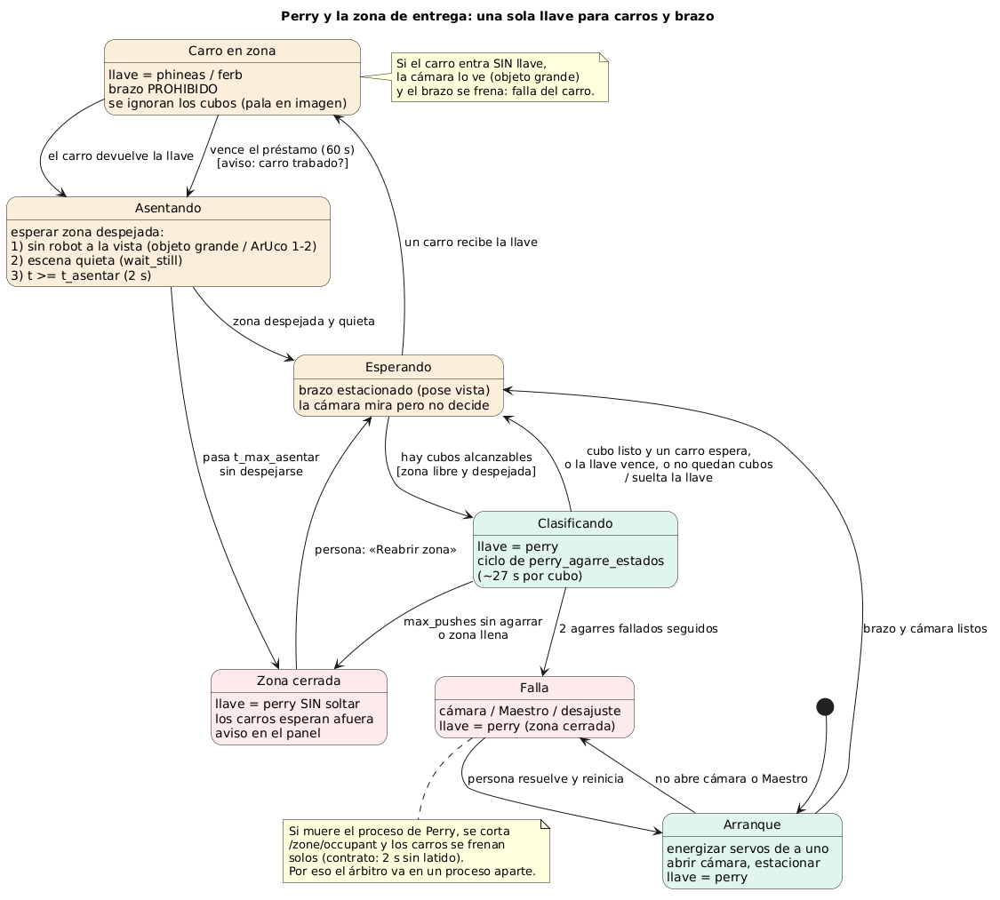

# Perry y la zona de entrega: estados, condiciones y casos borde

Borrador del 31-10-2026 para discutir con los equipos de Phineas, Ferb y con Cristian (comunicación).
Primero el **comportamiento**; el protocolo sale de acá, no al revés.
Diagrama: [`diagramas/perry_zona_estados.puml`](diagramas/perry_zona_estados.puml) (imagen generada abajo; si se
cambia el `.puml`, regenerar el `.png`).

## 1. El problema

La zona azul es un recurso compartido por tres máquinas que **no pueden estar ahí al mismo tiempo**:

- Phineas y Ferb meten la **pala** en la zona para dejar cubos.
- Perry baja el **brazo** a la zona para sacarlos.

Riesgos concretos (algunos ya pasaron):

1. **La cámara ve al robot como cubos.** La pala, las ruedas o las marcas de color de un carro dentro de la
   zona pueden detectarse como cubos. Perry podría intentar agarrar una pieza del robot.
2. **Choque brazo–robot.** El brazo baja mientras un carro está entrando o saliendo.
3. **Escena que cambia a mitad de ciclo.** Perry planifica con una foto, y un carro deja un cubo o empuja
   otro antes de que el brazo baje: el plan quedó viejo.
4. **Zona llena o trabada.** Cubos fuera de alcance, racimos que no se pueden separar, cubos sobre la cinta.
   Si los carros siguen trayendo, empeora.
5. **Falla de Perry.** Cámara, Maestro, desajuste. Los carros tienen que enterarse.

## 2. Lo que ya existe y conviene reutilizar

El contrato de los carros (`multirobot_interfaces`, repo `alejandrovielma/ucab-multirobot`) ya tiene un
**árbitro de la zona** que corre en la Pi de Perry:

| Pieza | Qué hace |
| --- | --- |
| `/zone/request {robot}` | Pide la zona. Responde `granted`, `holder` y `lease_seconds` (60 s) |
| `/zone/release {robot, delivered, color}` | Devuelve la zona. Con `delivered=true` suma al conteo oficial |
| `/zone/occupant` (2 Hz) | Quién tiene la zona (`""` = libre). **Si se corta más de 2 s, los carros se frenan** |
| `/<robot>/state` | `EXPLORE`, `APPROACH`, `CAPTURE`, `CARRY`, `DELIVER`, `STOP` |

Su plan ya prevé que **Perry pida la zona como un robot más** (`robot: perry`) antes de meter el brazo.
Esa es la idea central de este documento: **una sola llave para todos.** Quien tiene la llave entra; los
demás esperan afuera (los carros, a más de 30 cm).

**Ventaja:** para cerrar la zona (llena o en falla) no hace falta un mensaje nuevo. Perry toma la llave y
no la suelta: los carros ven `occupant = "perry"` y esperan.

## 3. Estados de Perry

| Estado | Brazo | Cámara | Llave de la zona |
| --- | --- | --- | --- |
| **ARRANQUE** | Se energiza y estaciona | Se abre y se verifica | El árbitro publica `perry` hasta terminar |
| **ESPERANDO** | Estacionado (pose `vista`) | Mira, **no decide** | Libre o en manos de un carro |
| **CARRO EN ZONA** | Estacionado, **prohibido moverse** | Ignora cubos (la pala está en la imagen) | De Phineas o Ferb |
| **ASENTANDO** | Estacionado | Espera zona despejada y quieta | Libre (el carro ya la devolvió) |
| **CLASIFICANDO** | Agarra, empuja, suelta (ciclo de [`perry_agarre_estados`](diagramas/perry_agarre_estados.puml)) | Antes de cada movimiento | **De Perry** |
| **ZONA CERRADA** | Estacionado | Sigue mirando | **De Perry, sin soltarla** |
| **FALLA** | Detenido o estacionado | Puede no andar | **De Perry**: la zona queda cerrada |

### Transiciones y condiciones

| Desde | Evento | Condición | Hacia |
| --- | --- | --- | --- |
| ARRANQUE | brazo y cámara listos | — | ESPERANDO |
| ARRANQUE | no abre la cámara o la Maestro | — | FALLA |
| ESPERANDO | un carro recibe la llave | — | CARRO EN ZONA |
| ESPERANDO | hay cubos para clasificar | zona libre **y** zona despejada | CLASIFICANDO (Perry toma la llave) |
| CARRO EN ZONA | el carro devuelve la llave | — | ASENTANDO |
| CARRO EN ZONA | vence el préstamo (60 s) sin devolución | — | ASENTANDO (con aviso: el carro pudo quedarse trabado) |
| ASENTANDO | zona despejada y quieta | ver sección 4 | ESPERANDO |
| ASENTANDO | pasa `t_max_asentar` y no se despeja | — | ZONA CERRADA (algo quedó en la zona) |
| CLASIFICANDO | cubo clasificado | la llave está por vencer o un carro la espera | suelta la llave → ESPERANDO |
| CLASIFICANDO | no quedan cubos alcanzables | — | suelta la llave → ESPERANDO |
| CLASIFICANDO | `max_pushes` empujes sin agarrar / zona llena | — | ZONA CERRADA |
| CLASIFICANDO | 2 agarres fallados seguidos | — | FALLA (posible desajuste) |
| ZONA CERRADA | una persona libera la zona (botón del panel) | — | ESPERANDO |
| FALLA | una persona la resuelve y reinicia | — | ARRANQUE |
| cualquiera | Cancelar en el panel | — | se detiene, estaciona y **cierra la zona** |

## 4. «Zona despejada»: no confiar solo en la llave

Que un carro haya devuelto la llave **no prueba que se fue**: puede haber quedado trabado con la pala
adentro. Por eso Perry no mueve el brazo sin que la **cámara** confirme las tres cosas:

1. **No hay robot a la vista.** Dentro de la zona más un margen alrededor, ningún objeto mucho más grande que
   un cubo, y ninguna marca ArUco de los robots (id 1 y 2).
2. **La escena está quieta.** Dos fotos seguidas casi iguales (ya existe: `wait_still`).
3. **Pasó un tiempo mínimo** desde la devolución (`t_asentar`, propuesta: 2 s), por si el cubo todavía
   está rodando.

**Respuesta a «¿cuánto esperar después de que dejan el cubo?»:** no conviene un tiempo fijo, sino estas
condiciones. El tiempo mínimo es solo un piso. Con la cámara actual, la espera real debería ser de 2 a 4 s.

## 5. Política de turnos

Datos: Perry tarda **~27 s por cubo** (22 a 34 s, medido en 18 agarres del 30 y 31-10). El préstamo dura
**60 s**, o sea **unos 2 cubos por turno**.

Propuesta:

- Perry **no acapara**: después de cada cubo, si un carro pidió la zona, suelta la llave.
- Excepción: si la zona está **casi llena** (más de N cubos alcanzables, N a definir), Perry tiene
  prioridad hasta bajar de N.
- Un carro esperando no espera más de ~1 ciclo de Perry (~30 s).

## 6. Casos borde: qué pasa si...

| Caso | Qué hace Perry | ¿Necesita protocolo? |
| --- | --- | --- |
| La cámara detecta la pala como cubos | Con un carro en la zona no decide nada (CARRO EN ZONA) | No: alcanza la llave |
| Un carro deja la llave pero no sale | Sigue en ASENTANDO; si pasa `t_max_asentar`, cierra la zona | No |
| Un carro se queda sin batería adentro | Vence el préstamo, la cámara lo sigue viendo y la zona se cierra | No; avisar en el panel |
| Un carro entra **sin** pedir la llave | La cámara lo ve (objeto grande) y Perry frena el brazo, si puede | Es una falla del carro: registrarla |
| Llega un cubo mientras el brazo trabaja | No debería: Perry tiene la llave | No |
| El cubo queda fuera de alcance (franja del fondo o pegado a la cinta) | Lo ignora y lo cuenta | Sí: avisar «cubo fuera de franja» para que el carro ajuste |
| Racimo que no se puede separar | Empuja hasta `max_pushes` y después ZONA CERRADA | Sí: los carros dejan de traer |
| Cubo rojo, u otro color sin caja | Lo ignora | Definir: ¿lo tiene que retirar una persona? |
| Un carro dice `color: azul` y la cámara ve amarillo | Usa lo que ve la cámara y registra la diferencia | No |
| `delivered=true` pero no aparece ningún cubo nuevo | Registra la diferencia de conteo | No; útil para el informe |
| Perry se cae (proceso muerto) | Se corta `/zone/occupant` y los carros se frenan solos | Ya resuelto por el contrato |
| Se reinicia la Pi de Perry | Igual que arriba; al volver, ARRANQUE con la zona cerrada | No |
| El brazo falla 2 veces seguidas | FALLA: zona cerrada y aviso en el panel | No |
| Se cancela desde el panel | El brazo se estaciona y la zona se cierra hasta que alguien la abra | No |
| Movieron la cámara | Las esquinas de la zona no coinciden: FALLA con aviso | No |

## 7. Pedidos hacia los carros (sugerencias del equipo, 31-10)

Perry no solo recibe: también puede **pedir**.

| Pedido | Para qué | Cómo encaja |
| --- | --- | --- |
| **«Traigan solo estos colores»** (por ejemplo, solo azules) | Una ronda o prueba con colores específicos; o una caja llena | Un campo `colores_pedidos`. Perry ya sabe ignorar colores (`--to` y `containers`); los carros filtrarían qué recogen |
| **«Dejen de traer»** | Zona llena, trabada o en falla | Ya cubierto: ZONA CERRADA. Perry retiene la llave |
| **«Pueden volver a traer»** | Se despejó la zona | Perry suelta la llave (o una persona la reabre) |

### Transporte: ¿ROS o la interfaz web de Perry?

Sugerencia de un compañero: lo más simple sería **reusar el servidor web del panel** (`audit_web.py`) y
exponer el estado y los pedidos en un puerto al que se conecten los carros (HTTP + JSON).

| | ROS 2 (`/zone/*`, contrato de los carros) | HTTP del panel de Perry |
| --- | --- | --- |
| Ya hecho | Los carros ya lo programaron; Cristian, la parte de Perry (rama `mejoras-de-portabilidad`) | El servidor ya existe; faltan 3 o 4 rutas |
| En la Pi de Perry | Necesita Docker (Debian 13 no tiene ROS) e imagen sin internet | Nada nuevo: ya corre hoy |
| Frenado si Perry se cae | Incluido: sin latido por 2 s, los carros paran | Hay que programarlo en los carros (si no responde en N s, parar) |
| Cambios en los carros | Ninguno | Un cliente HTTP en lugar del cliente ROS |

**La máquina de estados de este documento sirve igual con cualquiera de los dos**: solo cambia cómo viaja
«pido la llave» y «devuelvo la llave». Conviene decidirlo con los equipos de los carros y con Cristian.

## 8. Decisiones para tomar con los otros equipos

1. **¿El árbitro corre en el mismo proceso que el brazo, o aparte?** Recomendación: **aparte**. Si el
   brazo se cuelga, el árbitro sigue publicando y la zona queda cerrada con `perry`. Si el que se cae es el
   árbitro, los carros se frenan, que es lo seguro.
2. **¿Qué colores se llevan a la zona?** El contrato dice «todo menos rojo», pero Perry solo tiene cajas
   para **azul y amarillo**, y el último cambio de Phineas dice «un robot junta un solo color». Hay que
   confirmar.
3. **¿Cuántos cubos caben en la franja alcanzable** (entre 12 y 19,5 cm del eje) antes de cerrar la zona?
   Propuesta: medir con cubos reales.
4. **¿Por dónde entran los carros a la zona y hasta dónde mete la pala?** Define el margen de «zona
   despejada».
5. **¿Quién publica las poses de los carros?** El contrato dice que la cámara cenital de Perry, pero
   nuestra cámara solo ve la mesa del brazo, no la pista.
6. **¿Los carros llevan ArUco arriba?** Ayudaría mucho a detectar «robot en la imagen».
7. **Red y hora:** la Pi de Perry no tiene internet ni reloj (hoy estaba atrasada unos 200 días). El
   contrato pide `chrony` entre las tres Pi.

8. **¿ROS o HTTP?** Ver la tabla de la sección 7.

## 9. Qué se puede adelantar sin los carros

- Separar el árbitro del ciclo del brazo, con un modo simulado: un script hace de «carro» que pide y
  devuelve la llave.
- Detector de «zona despejada» (objeto grande o ArUco), probado con la mano o una caja dentro de la zona.
- Estado ZONA CERRADA y botón «Reabrir zona» en el panel.
- Tests con escenas guardadas: zona con un objeto grande, zona en movimiento, carro que no devuelve la llave.
