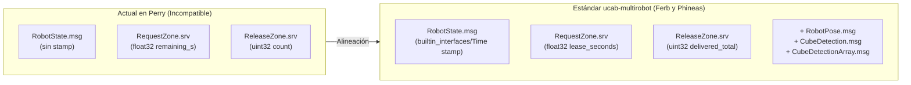

# Plan de Alineación de Perry (`Robot_Claw`) con `multirobot_interfaces` (Ferb y Phineas)

Este plan detalla los pasos exactos para alinear **Perry (la garra)** con el paquete oficial `multirobot_interfaces` de [`alejandrovielma/ucab-multirobot`](https://github.com/alejandrovielma/ucab-multirobot) usado por **Ferb** y **Phineas**, eliminando cualquier incompatibilidad de serialización CDR/DDS en ROS 2 sin alterar la lógica interna del brazo ni del árbitro de zona.

---

## 1. Resumen de Diferencias a Corregir



---

## 2. Fases de Ejecución

### Fase 1: Reemplazo íntegro de `src/multirobot_interfaces`
**Objetivo:** Tener exactamente el mismo paquete `multirobot_interfaces` (commit `c2e17ef` de `ucab-multirobot`) para que los hashes de tipo (`RIHS01`) y el layout binario CDR coincidan bit a bit entre los 3 robots.

1. **Archivos en [`src/multirobot_interfaces/`](file:///c:/Users/crist/Documents/GitHub/Robot_Claw/src/multirobot_interfaces):**
   - **Actualizar [`msg/RobotState.msg`](file:///c:/Users/crist/Documents/GitHub/Robot_Claw/src/multirobot_interfaces/msg/RobotState.msg):**
     ```text
     builtin_interfaces/Time stamp
     string robot
     string state
     bool carrying
     uint32 delivered
     bool gate_closed
     ```
   - **Actualizar [`srv/RequestZone.srv`](file:///c:/Users/crist/Documents/GitHub/Robot_Claw/src/multirobot_interfaces/srv/RequestZone.srv):**
     ```text
     string robot
     ---
     bool granted
     string holder
     float32 lease_seconds
     ```
   - **Actualizar [`srv/ReleaseZone.srv`](file:///c:/Users/crist/Documents/GitHub/Robot_Claw/src/multirobot_interfaces/srv/ReleaseZone.srv):**
     ```text
     string robot
     bool delivered
     string color
     ---
     bool ok
     uint32 delivered_total
     ```
   - **Agregar los mensajes adicionales del paquete oficial:**
     - `msg/RobotPose.msg`
     - `msg/CubeDetection.msg`
     - `msg/CubeDetectionArray.msg`
   - **Actualizar [`CMakeLists.txt`](file:///c:/Users/crist/Documents/GitHub/Robot_Claw/src/multirobot_interfaces/CMakeLists.txt) y [`package.xml`](file:///c:/Users/crist/Documents/GitHub/Robot_Claw/src/multirobot_interfaces/package.xml):**
     - Añadir `find_package(builtin_interfaces REQUIRED)` y `DEPENDENCIES builtin_interfaces` en `rosidl_generate_interfaces(...)` junto con los 6 archivos (`.msg` y `.srv`).
     - Añadir `<depend>builtin_interfaces</depend>` en `package.xml`.

> [!IMPORTANT]
> **Regla de mantenimiento:** Una vez reemplazado `src/multirobot_interfaces`, no se debe editar manualmente ningún `.msg` o `.srv` local en `Robot_Claw`. Cualquier cambio futuro debe originarse en `ucab-multirobot` y copiarse tal cual.

---

### Fase 2: Adaptación del Nodo ROS 2 de Perry ([`perry/ros_node.py`](file:///c:/Users/crist/Documents/GitHub/Robot_Claw/perry/ros_node.py))
**Objetivo:** Poblar el nuevo campo `stamp` y asignar los nombres exactos de los atributos de respuesta en los servicios, además de evitar saturación de logs por reintentos de los carros.

1. **En [`PerryFleetNode._publish_loop()`](file:///c:/Users/crist/Documents/GitHub/Robot_Claw/perry/ros_node.py#L122-L136):**
   - Agregar la marca de tiempo del reloj de ROS antes de publicar `/perry/state`:
     ```python
     st_msg = RobotState()
     st_msg.stamp = self.get_clock().now().to_msg()
     st_msg.robot = "perry"
     st_msg.state = self.arbiter.state.value
     st_msg.carrying = bool(self.arbiter.carrying)
     st_msg.delivered = int(self.arbiter.sorted_total)
     st_msg.gate_closed = bool(self.arbiter.state == PerryState.BLOCKED)
     self._state_pub.publish(st_msg)
     ```
2. **En [`PerryFleetNode._handle_request_zone()`](file:///c:/Users/crist/Documents/GitHub/Robot_Claw/perry/ros_node.py#L141-L148):**
   - Cambiar `response.remaining_s` por `response.lease_seconds`:
     ```python
     granted, holder, remaining_s = self.arbiter.request_zone(robot)
     response.granted = bool(granted)
     response.holder = str(holder)
     response.lease_seconds = float(remaining_s)
     ```
   - **Control de ruido en logs (Nota del equipo de Ferb):** Guardar el último resultado `(robot, granted, holder)` para loguear con `self.get_logger().info(...)` cuando se concede o cambia el estado, y usar `self.get_logger().debug(...)` cuando un carro repite la misma petición rechazada mientras espera afuera.
3. **En [`PerryFleetNode._handle_release_zone()`](file:///c:/Users/crist/Documents/GitHub/Robot_Claw/perry/ros_node.py#L150-L157):**
   - Cambiar `response.count` por `response.delivered_total`:
     ```python
     ok, count = self.arbiter.release_zone(robot, delivered=bool(request.delivered), color=color)
     response.ok = bool(ok)
     response.delivered_total = int(count)
     ```

*(Nota: [`perry/zone_arbiter.py`](file:///c:/Users/crist/Documents/GitHub/Robot_Claw/perry/zone_arbiter.py), [`perry/sort_cubes.py`](file:///c:/Users/crist/Documents/GitHub/Robot_Claw/perry/sort_cubes.py) y [`perry/audit_web.py`](file:///c:/Users/crist/Documents/GitHub/Robot_Claw/perry/audit_web.py) no requieren cambios porque consumen tuplas y diccionarios internos de Python).*

---

### Fase 3: Actualización de Pruebas Unitarias ([`perry/tests/test_ros_node.py`](file:///c:/Users/crist/Documents/GitHub/Robot_Claw/perry/tests/test_ros_node.py))
**Objetivo:** Asegurar que la suite de pruebas verifique los nuevos nombres de campos del contrato ROS 2.

1. En [`test_node_request_and_release_callbacks()`](file:///c:/Users/crist/Documents/GitHub/Robot_Claw/perry/tests/test_ros_node.py#L37-L73):
   - Actualizar `res.remaining_s` → `res.lease_seconds`.
   - Actualizar `rel_res.count` → `rel_res.delivered_total`.
2. Ejecutar `py -m pytest perry/tests` para confirmar que las pruebas de `zone_arbiter`, `ros_node` y `audit_web` pasan al 100%.

---

### Fase 4: Limpieza de Compilación en Docker ([`docker/entrypoint.sh`](file:///c:/Users/crist/Documents/GitHub/Robot_Claw/docker/entrypoint.sh))
**Objetivo:** Evitar que una caché previa de `build/` o `install/` en la Raspberry Pi mantenga las interfaces viejas generadas por `rosidl`.

1. Verificar en [`docker/entrypoint.sh`](file:///c:/Users/crist/Documents/GitHub/Robot_Claw/docker/entrypoint.sh#L10-L16) que `colcon build --symlink-install` recompile `multirobot_interfaces` limpiamente.
2. Documentar el comando de limpieza única al actualizar en la Raspberry Pi:
   ```bash
   rm -rf build/ install/ log/
   docker compose up --build -d
   ```

---

### Fase 5: Actualización de la Documentación del Proyecto
**Objetivo:** Dejar toda la documentación sincronizada con los nombres de campos definitivos.

1. Actualizar **[`docs/referencia_comunicacion_carros.md`](file:///c:/Users/crist/Documents/GitHub/Robot_Claw/docs/referencia_comunicacion_carros.md)**:
   - Incluir `builtin_interfaces/Time stamp` en `RobotState.msg`.
   - Cambiar `remaining_s` → `lease_seconds` en la especificación y en el diagrama Mermaid de `/zone/request`.
   - Cambiar `count` → `delivered_total` en la especificación y en el diagrama Mermaid de `/zone/release`.
2. Actualizar **[`docs/plan_de_implementacion_de_comunicacion.md`](file:///c:/Users/crist/Documents/GitHub/Robot_Claw/docs/plan_de_implementacion_de_comunicacion.md)** para que refleje los mismos nombres de campos.

---

## 3. Lista de Verificación post-implementación

1. **En PC (sin ROS 2):**
   ```powershell
   py -m pytest perry/tests -v
   ```
2. **En el contenedor Docker de Perry (con ROS 2):**
   ```bash
   ros2 interface show multirobot_interfaces/msg/RobotState
   # Debe mostrar: builtin_interfaces/Time stamp como primer campo

   ros2 interface show multirobot_interfaces/srv/RequestZone
   # Debe mostrar: float32 lease_seconds en la respuesta

   ros2 interface show multirobot_interfaces/srv/ReleaseZone
   # Debe mostrar: uint32 delivered_total en la respuesta
   ```
3. **En red con Ferb y Phineas (`ROS_DOMAIN_ID=0`):**
   - `ros2 topic echo /perry/state` muestra `stamp`, `robot: perry`, `state`, `carrying`, `delivered`, `gate_closed`.
   - El panel web de Perry (`http://<IP_PERRY>:8000`) muestra el estado en vivo de **Ferb** y **Phineas** al recibir `/ferb/state` y `/phineas/state`.
   - Las llamadas de Ferb a `/zone/request` y `/zone/release` responden con `lease_seconds: 60.0` y `delivered_total`.

