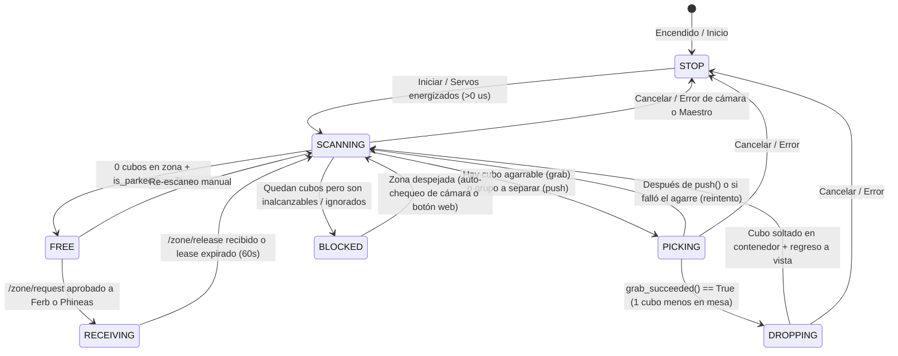

# Plan de Implementación: Comunicación ROS 2 y Máquina de Estados de Perry

Este documento detalla el plan por fases para conectar **Perry (la garra)** en [`Robot_Claw`](file:///C:/Users/crist/Documents/GitHub/Robot_Claw) con los robots recolectores **Ferb** ([`Ferb-Recolector`](file:///C:/Users/crist/Documents/GitHub/Ferb-Recolector)) y **Phineas**, incluyendo las acciones físicas y verificaciones de seguridad que realiza el brazo en cada estado.

---

## 1. Máquina de Estados de Perry y Acciones Físicas por Estado



### Tabla de Estados, Verificaciones Físicas y Mensajes ROS 2

| Estado (`RobotState.state` en `/perry/state`) | `/zone/occupant` (2 Hz) | `carrying` | Acciones Físicas y Comprobaciones de la Garra | Qué hacen Ferb y Phineas |
| :--- | :--- | :--- | :--- | :--- |
| **`STOP`** *(Detenido / Inicial / Error)* | `"perry"` | `False` | 1. **Al encender:** Si algún servo lee `0 µs` (`m.get_us(ch) == 0`), **no mueve nada** para evitar tirones bruscos y pide energizar.<br>2. **Al cancelar en marcha:** Sube en vertical a `travel` (`hombro: 1450, codo: 1300, muneca: 2000`) y estaciona en `poses.vista` (`base: 2100`). | No pueden pedir zona (`granted=False`). Reciben heartbeat para no bloquear motores en pista. |
| **`SCANNING`** *(Escaneando zona)* | `"perry"` | `False` | 1. Ejecuta `ensure_parked(m, cfg)`: mueve a `travel` + `vista` si no está ahí y espera `0.5 s` de quietud.<br>2. Captura frame con [`TopCamera.find_cubes()`](file:///C:/Users/crist/Documents/GitHub/Robot_Claw/perry/vision.py#L119-L150).<br>3. Ejecuta [`decide()`](file:///C:/Users/crist/Documents/GitHub/Robot_Claw/perry/planner.py#L42-L71) y guarda fotos `vistaN.jpg` y `planN.jpg`. | Esperan fuera de la zona (`> 30 cm`) mientras Perry evalúa la imagen (~1–2 s). |
| **`FREE`** *(Libre / En reposo verificado)* | `""` *(vacío)* | `False` | **Requisito estricto antes de emitir `""`:**<br>1. El último escaneo dio `0 cubos` en la zona.<br>2. **`is_parked(m, cfg)` es `True`**: verifica leyendo `m.get_us()` en la Pololu que ningún canal esté en `0 µs`, que `not m.is_moving()`, que `hombro/codo/muneca` estén en `travel` (`±30 µs`) y `base` en `poses.vista` (`2100 ± 30 µs`, girado a la derecha sobre la caja verde, fuera de la zona). | **Zona abierta:** El carro que tenga un cubo pide `/zone/request` y recibe permiso inmediato. |
| **`RECEIVING`** *(Recibiendo entrega de carro)* | `"ferb"` o `"phineas"` | `False` | 1. **Bloqueo por software del brazo:** Mientras haya un lease activo de un carro, cualquier orden de bajar el brazo queda bloqueada.<br>2. El brazo permanece inmóvil en `vista` + `travel`. | El carro con el lease entra a la zona, suelta el cubo, retrocede y llama `/zone/release`. El otro carro espera afuera. |
| **`PICKING`** *(Recogiendo o separando)* | `"perry"` | `False` | - **Si es `grab`** ([`pick()`](file:///C:/Users/crist/Documents/GitHub/Robot_Claw/perry/sort_cubes.py#L88-L98)): abre pinza (`750 µs`), va por arriba a `(x, y)` compensando el juego de la base (`-100 µs`), gira muñeca a `grasp_dir`, baja lento el hombro (`speed=6`), cierra firme (`1700 µs`), sube a `travel`, va a `vista` y verifica contando cubos ([`grab_succeeded()`](file:///C:/Users/crist/Documents/GitHub/Robot_Claw/perry/grasp.py#L193-L200)).<br>- **Si es `push`** ([`push()`](file:///C:/Users/crist/Documents/GitHub/Robot_Claw/perry/reach.py#L85-L116)): cierra pinza, baja a media altura y empuja el bloque en pasos de `0.5 cm`, sube a `travel`. | Prohibido entrar a la zona (`granted=False`). Siguen recolectando en la pista o esperan turno afuera. |
| **`DROPPING`** *(Depositando en caja)* | `"perry"` | `True` | 1. Ejecuta [`drop()`](file:///C:/Users/crist/Documents/GitHub/Robot_Claw/perry/sort_cubes.py#L100-L104): lleva el cubo por arriba a la pose fija del contenedor (`amarillo` izq. o `verde` der.).<br>2. Abre pinza (`750 µs`), espera `0.3 s`, sube a `travel` y regresa a `vista`.<br>3. Suma 1 al contador `classified_total`. | Prohibido entrar todavía; saben que Perry ya levantó el cubo (`carrying=True`) y está por terminar. |
| **`BLOCKED`** *(Zona bloqueada)* | `"perry"` | `False` | 1. Ejecuta `ensure_parked(m, cfg)` (abre pinza y estaciona en `vista` + `travel`).<br>2. Mantiene la cámara vigilando la zona cada `3 s`: si los cubos inalcanzables/trabados son retirados (`len(cubes) == 0`), pasa solo a `SCANNING` → `FREE`. | Prohibido entrar a entregar (`granted=False`) para evitar que el rastrillo del carro choque con los cubos atascados. |

---

## 2. Plan de Implementación por Fases

### Fase 1: Verificación Física de Posición de Reposo en `perry/reach.py`
**Objetivo:** Garantizar por hardware que Perry nunca declare la zona `FREE` ni acepte un carro si el brazo está caído, desenergizado o dentro de la zona.

- **Archivos a modificar:**
  - [`perry/reach.py`](file:///C:/Users/crist/Documents/GitHub/Robot_Claw/perry/reach.py)
  - [`perry/config/arm.yaml`](file:///C:/Users/crist/Documents/GitHub/Robot_Claw/perry/config/arm.yaml)
- **Qué se implementará:**
  1. Función `is_energized(m, cfg) -> bool`: comprueba que todos los canales en `arm.yaml` (`base`, `hombro`, `codo`, `muneca`, `giro`, `pinza`) devuelvan `m.get_us(ch) > 0`.
  2. Función `is_parked(m, cfg, tol_us=30) -> bool`: comprueba que `is_energized(m, cfg)` sea verdadero, `not m.is_moving()`, y que los pulsos actuales de `hombro`, `codo`, `muneca` coincidan con `cfg["travel"]` y `base` coincida con `cfg["poses"]["vista"]["base"]` dentro de `±tol_us`.
  3. Función `ensure_parked(m, cfg) -> bool`: si `is_energized()` es falso, devuelve `False` sin mover; si está energizado pero fuera de lugar, ejecuta `move_via_top(m, cfg, cfg["poses"]["vista"], precise_base=False)` y retorna `is_parked(m, cfg)`.

---

### Fase 2: Lógica Pura de Estados y Árbitro de Zona (`perry/zone_arbiter.py`)
**Objetivo:** Implementar la máquina de estados y las reglas de préstamo de la zona (*lease*) sin depender de `rclpy`, con pruebas unitarias en `pytest`.

- **Archivos a crear:**
  - `perry/zone_arbiter.py`
  - `perry/tests/test_zone_arbiter.py`
- **Qué se implementará:**
  1. Enum `PerryState`: `STOP`, `SCANNING`, `FREE`, `RECEIVING`, `PICKING`, `DROPPING`, `BLOCKED`.
  2. Clase `ZoneArbiter` (thread-safe con `threading.Lock`):
     - Atributos: `state` (`PerryState`), `holder` (`""`, `"ferb"`, `"phineas"`), `lease_expires_at`, `delivered_total` (reportados por carros), `sorted_total` (clasificados por Perry), `carrying` (`bool`), `parked_ok` (`bool`).
     - Propiedad `occupant_msg -> str`: devuelve `""` **solo si** `state == PerryState.FREE` y `parked_ok == True`; devuelve `"ferb"` o `"phineas"` si `state == PerryState.RECEIVING`; en cualquier otro estado devuelve `"perry"`.
     - Método `request_zone(robot: str, now: float) -> tuple[bool, str, float]`:
       - Concede o renueva el lease de `60.0 s` únicamente si `state == PerryState.FREE` y `parked_ok == True` (o si `state == PerryState.RECEIVING` y `holder == robot`).
       - Al conceder, cambia `state` a `PerryState.RECEIVING`.
     - Método `release_zone(robot: str, delivered: bool, color: str, now: float) -> tuple[bool, int]`:
       - Si `delivered` es `True`, incrementa `delivered_total`.
       - Limpia `holder`, cambia `state` a `PerryState.SCANNING` y activa el flag `trigger_sort = True` para que el hilo del brazo escanee y recoja el cubo.
     - Método `tick(now: float)`: verifica si el lease de `60.0 s` de un carro venció; si venció, pasa de `RECEIVING` a `SCANNING` y solicita escaneo.

---

### Fase 3: Integración del Ciclo de Clasificación (`perry/sort_cubes.py`)
**Objetivo:** Conectar [`sort_loop()`](file:///C:/Users/crist/Documents/GitHub/Robot_Claw/perry/sort_cubes.py#L107-L190) con `ZoneArbiter` para que actualice el estado en cada paso y verifique el estacionamiento al terminar.

- **Archivos a modificar:**
  - [`perry/sort_cubes.py`](file:///C:/Users/crist/Documents/GitHub/Robot_Claw/perry/sort_cubes.py)
- **Qué se implementará:**
  1. Antes de iniciar el bucle: verificar que no haya un carro con lease activo (`state != RECEIVING`) y que `ensure_parked(m, cfg)` sea `True`.
  2. En cada etapa de [`sort_loop()`](file:///C:/Users/crist/Documents/GitHub/Robot_Claw/perry/sort_cubes.py#L107-L190):
     - Antes de `look()` + `decide()` → `arbiter.set_state(SCANNING, carrying=False)`.
     - Antes de `pick()` o `push()` → `arbiter.set_state(PICKING, carrying=False)`.
     - Si `grab_succeeded()` es `True`, antes de `drop()` → `arbiter.set_state(DROPPING, carrying=True)`.
  3. Al salir del bucle:
     - Ejecutar `parked = ensure_parked(m, cfg)`.
     - Si fue cancelado o falló `parked` → `arbiter.set_state(STOP)`.
     - Si quedaron cubos en la zona (`len(cubes) > 0` que no se pudieron agarrar) → `arbiter.set_state(BLOCKED)`.
     - Si no quedan cubos (`len(cubes) == 0`) y `parked == True` → `arbiter.set_state(FREE)`.

---

### Fase 4: Paquete `multirobot_interfaces` y Nodo ROS 2 (`perry/ros_node.py`)
**Objetivo:** Exponer a la red ROS 2 los tópicos y servicios exactos que esperan [`Ferb-Recolector`](file:///C:/Users/crist/Documents/GitHub/Ferb-Recolector) y Phineas.

- **Archivos a crear:**
  - `src/multirobot_interfaces/` (copia exacta de [`Ferb-Recolector/src/multirobot_interfaces`](file:///C:/Users/crist/Documents/GitHub/Ferb-Recolector/src/multirobot_interfaces)).
  - `perry/ros_node.py`
- **Qué se implementará en `perry/ros_node.py`:**
  1. Nodo `PerryFleetNode(Node)` corriendo en un `threading.Thread(daemon=True)`:
     - **Publicador `/zone/occupant`** (`std_msgs/msg/String`, `2 Hz`, `RELIABLE`, `TRANSIENT_LOCAL`, `depth=1`): publica `arbiter.occupant_msg`.
     - **Publicador `/perry/state`** (`multirobot_interfaces/msg/RobotState`, `2 Hz`): publica `stamp=self.get_clock().now().to_msg()`, `robot="perry"`, `state=arbiter.state.value`, `carrying=arbiter.carrying`, `delivered=arbiter.sorted_total`, `gate_closed=(arbiter.state == BLOCKED)`.
     - **Servicio `/zone/request`** (`RequestZone`): llama a `arbiter.request_zone()` y responde con `lease_seconds`.
     - **Servicio `/zone/release`** (`ReleaseZone`): llama a `arbiter.release_zone()` y responde con `delivered_total`.
     - **Suscriptores `/ferb/state` y `/phineas/state`** (`RobotState`): guardan el último estado de ambos carros para mostrarlo en el panel web de Perry.
  2. Si `rclpy` no está instalado (ej. corriendo en Windows sin Docker), `start_ros_node()` continúa sin error en modo local.

---

### Fase 5: Panel Web (`perry/audit_web.py`) y Entorno Docker en Raspberry Pi
**Objetivo:** Controlar y monitorear la flota desde el navegador y dejar listo el contenedor Docker para la Raspberry Pi de Perry.

- **Archivos a modificar / crear:**
  - [`perry/audit_web.py`](file:///C:/Users/crist/Documents/GitHub/Robot_Claw/perry/audit_web.py)
  - [`perry/config/arm.yaml`](file:///C:/Users/crist/Documents/GitHub/Robot_Claw/perry/config/arm.yaml)
  - `docker/Dockerfile`, `docker/entrypoint.sh`, `compose.yaml`
- **Qué se implementará:**
  1. **En [`audit_web.py`](file:///C:/Users/crist/Documents/GitHub/Robot_Claw/perry/audit_web.py):**
     - Mostrar en vivo el estado de Perry (`FREE`, `RECEIVING`, `SCANNING`, `PICKING`, `DROPPING`, `BLOCKED`, `STOP`), quién ocupa la zona, el conteo `delivered_total` / `sorted_total` y el estado de `Ferb` y `Phineas`.
     - Cuando `arbiter.trigger_sort` se activa tras un `/zone/release` (y `auto_sort_on_release: true`), lanzar automáticamente `run_cycle("run")`.
     - En estado `BLOCKED`, revisar cada `3 s` en `camera_loop()` si los cubos atascados ya fueron retirados para volver a `FREE` tras verificar `ensure_parked()`.
     - Botones en la web para **Habilitar Zona (`FREE`)** (previa verificación de pose `vista` y 0 cubos) y **Bloquear Zona (`STOP`)**.
  2. **En Docker (`docker/Dockerfile` y `compose.yaml`):**
     - Imagen basada en `ros:lyrical-ros-base` (igual que [`Ferb-Recolector`](file:///C:/Users/crist/Documents/GitHub/Ferb-Recolector/docker/Dockerfile)) con `python3-opencv`, `python3-serial`, `python3-yaml`, `python3-numpy`.
     - `compose.yaml` con `network_mode: host`, `privileged: true`, `/dev:/dev` y montaje del repositorio en `/ws`.

---

## 3. Verificación por Fase

1. **Pruebas unitarias en PC (Fases 1–3):**
   ```powershell
   py -m pytest perry/tests
   ```
   Valida todas las transiciones de `ZoneArbiter`, que `occupant` nunca sea `""` si `parked_ok == False` o si quedan cubos bloqueados, y que los leases expiren y se renueven correctamente.
2. **Prueba con Docker y ROS 2 (Fases 4–5):**
   Ejecutar los mismos 4 pasos de [`field-test-fleet-link.md`](file:///C:/Users/crist/Documents/GitHub/Ferb-Recolector/docs/field-test-fleet-link.md):
   - `ros2 topic echo /zone/occupant` y `ros2 topic echo /perry/state`
   - `ros2 service call /zone/request multirobot_interfaces/srv/RequestZone "{robot: ferb}"`
   - `ros2 service call /zone/release multirobot_interfaces/srv/ReleaseZone "{robot: ferb, delivered: true, color: 'blue'}"`
