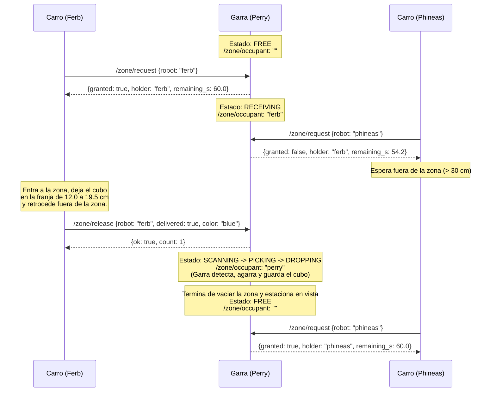

# Guía de Referencia de Comunicación: Perry (La Garra) ↔ Carros Recolectores (Ferb y Phineas)

Este documento es la referencia oficial de interfaz para el equipo que desarrolla los carros recolectores (**Ferb** y **Phineas**). Describe exactamente cómo comunicarse por **ROS 2** con **Perry (la garra)**, qué mensajes e información transmite la garra en cada momento, cómo funciona el préstamo (*lease*) de la zona de entrega y cuáles son las restricciones físicas de la zona para que la garra pueda recoger los cubos.

---

## 1. Configuración de Red y Entorno ROS 2

- **Middleware:** ROS 2 (compatible con el paquete `multirobot_interfaces`).
- **`ROS_DOMAIN_ID`:** `0` (todos los contenedores deben estar en `network_mode: host` en la misma subred Wi-Fi y con `ROS_DOMAIN_ID=0`).
- **Identificadores de robot (`robot`):**
  - `"perry"` → Brazo clasificador (árbitro de la zona).
  - `"ferb"` → Carro recolector 1.
  - `"phineas"` → Carro recolector 2.
  *(Nota: Perry normaliza los nombres a minúsculas y sin espacios).*

---

## 2. Resumen de Tópicos y Servicios

| Nombre | Tipo | Dirección (visto desde el Carro) | Frecuencia / QoS | Propósito |
| :--- | :--- | :--- | :--- | :--- |
| `/zone/occupant` | `std_msgs/msg/String` | **Suscribirse** (Publica Perry) | `2 Hz` (`RELIABLE`, `TRANSIENT_LOCAL`, `depth=1`) | **Heartbeat y dueño actual de la zona.** Indica si la zona está libre (`""`), ocupada por un carro (`"ferb"` / `"phineas"`) u ocupada por la garra (`"perry"`). |
| `/perry/state` | `multirobot_interfaces/msg/RobotState` | **Suscribirse** (Publica Perry) | `2 Hz` (`RELIABLE`, `KEEP_LAST`, `depth=5`) | **Estado detallado de la garra:** qué está haciendo exactamente, si sostiene un cubo, cuántos cubos lleva clasificados y si la zona está bloqueada. |
| `/zone/request` | `multirobot_interfaces/srv/RequestZone` | **Llamar servicio** (Servidor en Perry) | Bajo demanda | **Pedir permiso (o renovar lease) para entrar** a la zona de entrega. |
| `/zone/release` | `multirobot_interfaces/srv/ReleaseZone` | **Llamar servicio** (Servidor en Perry) | Bajo demanda | **Avisar que el carro ya salió de la zona** e indicar si dejó cubo(s). Dispara automáticamente el ciclo de la garra. |
| `/ferb/state`<br>`/phineas/state` | `multirobot_interfaces/msg/RobotState` | **Publicar** (Se suscribe Perry) | `~1–2 Hz` | **Reporte de estado del carro** para visualización en el panel web de auditoría de Perry. |

---

## 3. ¿Qué envía la garra a los carros?

### 3.1. Tópico `/zone/occupant` (`std_msgs/msg/String`) — Heartbeat y Ocupación

Perry publica este mensaje cada **0.5 segundos (2 Hz)**. Cumple dos funciones críticas para los carros:
1. **Heartbeat de seguridad:** Mientras los carros reciban este tópico, saben que el nodo de Perry está vivo. Si dejan de recibirlo por más de `2.0 s`, el `obstacle_guard` del carro debe detener el movimiento por seguridad.
2. **Semáforo de la zona (`msg.data`):**

| Valor de `data` | Significado | ¿Puede entrar el carro a la zona? |
| :--- | :--- | :--- |
| `""` *(string vacío)* | **Zona LIBRE.** No hay cubos pendientes y el brazo está verificado físicamente en su posición de reposo (`vista`), fuera del área de entrega. | **No todavía:** primero debe llamar a `/zone/request` y recibir `granted: true`. |
| `"ferb"` | **Zona reservada para Ferb** (lease activo). El brazo está bloqueado por software en reposo. | **Solo Ferb** puede entrar. Phineas debe esperar afuera (`> 30 cm`). |
| `"phineas"` | **Zona reservada para Phineas** (lease activo). El brazo está bloqueado por software en reposo. | **Solo Phineas** puede entrar. Ferb debe esperar afuera (`> 30 cm`). |
| `"perry"` | **Zona OCUPADA por la garra** (escaneando, moviendo el brazo, bloqueada por cubo mal puesto o en parada). | **PROHIBIDO ENTRAR.** Ambos carros deben mantenerse fuera de la zona (`> 30 cm`). |

---

### 3.2. Tópico `/perry/state` (`multirobot_interfaces/msg/RobotState`) — Estado Detallado

Definición del mensaje `RobotState.msg`:
```text
string robot        # Siempre "perry"
string state        # Estado actual de la máquina de estados de Perry (ver tabla abajo)
bool carrying       # true si la pinza verificó que lleva un cubo en el aire hacia la caja
uint32 delivered    # Total acumulado de cubos clasificados con éxito por Perry en sus contenedores
bool gate_closed    # true cuando state == "BLOCKED" (hay cubos atascados/inalcanzables en la zona)
```

#### Tabla de Estados que envía Perry en `/perry/state`

| `state` | `/zone/occupant` | `carrying` | `gate_closed` | Qué está haciendo físicamente la garra | Qué debe hacer el carro |
| :--- | :---: | :---: | :---: | :--- | :--- |
| **`FREE`** | `""` | `false` | `false` | Estacionada arriba y a la derecha (`vista`), sin moverse y con **0 cubos** en la zona. | Si trae un cubo listo para entregar, **llamar a `/zone/request`**. |
| **`RECEIVING`** | `"ferb"` o `"phineas"` | `false` | `false` | Inmóvil en `vista` esperando a que el carro con permiso termine su maniobra de entrega. | **El carro con el lease:** entra, suelta el cubo, retrocede fuera de la zona y llama a `/zone/release`.<br>**El otro carro:** espera afuera. |
| **`SCANNING`** | `"perry"` | `false` | `false` | En pose `vista`, tomando foto con la cámara cenital y calculando cómo agarrar o separar los cubos (~1–2 s). | **Esperar fuera de la zona** (o seguir buscando cubos en la pista). |
| **`PICKING`** | `"perry"` | `false` | `false` | **Brazo dentro de la zona:** bajando a agarrar un cubo (`pick`), empujando cubos pegados para separarlos (`push`) o subiendo a `vista` para verificar con la cámara si el cubo subió. | **Prohibido acercarse a la zona.** Peligro de colisión física con el brazo. |
| **`DROPPING`** | `"perry"` | `true` | `false` | El agarre fue exitoso. Llevando el cubo por alto hacia el contenedor correspondiente (caja amarilla o verde) y soltándolo. | **Esperar fuera de la zona.** El carro puede saber que a Perry le quedan pocos segundos para terminar ese cubo. |
| **`BLOCKED`** | `"perry"` | `false` | `true` | El brazo se estacionó en `vista`, pero **quedaron cubos tirados en la zona que Perry no puede recoger** (cayeron fuera del radio de alcance `11.9–19.5 cm` o fallaron todos los intentos). Perry re-chequea con la cámara cada `3 s` por si se despeja. | **NO entrar a dejar más cubos** (si un carro entra, su rastrillo chocará o empujará los cubos atascados). Esperar a que vuelva a `FREE`. |
| **`STOP`** | `"perry"` | `false` | `false` | Parada manual desde el panel web, servos desenergizados al encender (`0 µs`) o error de hardware. | **No pedir zona** (`granted` será `false`). Mientras siga llegando `/zone/occupant`, los carros pueden seguir buscando en pista pero sin entregar. |

---

## 4. Servicios para Coordinar la Entrega

### 4.1. Pedir entrada a la zona: `/zone/request` (`multirobot_interfaces/srv/RequestZone`)

El carro debe llamar a este servicio **antes de entrar al área de entrega** (estando a `> 30 cm` de distancia).

**Estructura del servicio (`RequestZone.srv`):**
```text
string robot          # "ferb" o "phineas"
---
bool granted          # true = tiene permiso para entrar | false = permiso denegado, esperar afuera
string holder         # Quién tiene actualmente la zona ("ferb", "phineas" o "perry")
float32 remaining_s   # Segundos restantes del lease actual (60.0 s al concederse o renovarse)
```

**Reglas del servidor en Perry:**
1. **Concesión (`granted = true`):** Solo se otorga si Perry está en **`FREE`** (con el brazo verificado físicamente en reposo). Al otorgarlo, Perry pasa a **`RECEIVING`**, asigna `holder = robot` por **60.0 segundos** y publica `holder` en `/zone/occupant`.
2. **Renovación (`granted = true`):** Si el mismo carro que ya posee el lease vuelve a llamar a `/zone/request` antes de que expiren los 60 s, Perry le renueva el contador a `60.0 s`.
3. **Rechazo (`granted = false`):** Si Perry está en cualquier otro estado (`SCANNING`, `PICKING`, `DROPPING`, `BLOCKED`, `STOP`) o si el lease lo tiene el otro carro, responde `granted = false` e informa en `holder` quién ocupa la zona (`"perry"` o el otro carro).

---

### 4.2. Liberar la zona tras entregar: `/zone/release` (`multirobot_interfaces/srv/ReleaseZone`)

El carro **debe llamar a este servicio únicamente cuando ya haya retrocedido y salido por completo de la zona de entrega**, porque apenas Perry recibe este llamado, el brazo empezará a operar.

**Estructura del servicio (`ReleaseZone.srv`):**
```text
string robot          # "ferb" o "phineas" (debe coincidir con el holder actual)
bool delivered        # true si dejó al menos un cubo en la zona; false si abortó y salió sin dejar nada
string color          # Color reportado por el carro (ej. "blue", "yellow", "azul", "amarillo" o "")
---
bool ok               # true si la liberación fue aceptada; false si el carro no tenía el lease
uint32 count          # Total acumulado de entregas reportadas por los carros a Perry
```

**¿Qué hace Perry al recibir `/zone/release`?**
1. Verifica que `robot` sea el dueño actual del lease.
2. Si `delivered == true`, incrementa el contador de entregas recibidas (`count`).
3. Limpia el `holder` e **inmediatamente cambia su estado a `SCANNING` (`occupant = "perry"`)**, disparando de forma automática el ciclo de visión y clasificación de la garra (`sort_loop`).
4. *Nota sobre múltiples cubos:* Aunque `delivered` es un booleano, la cámara cenital de Perry detecta todos los cubos presentes en la zona y la garra los recogerá **uno por uno** hasta vaciar la zona antes de volver a `FREE`.

---

### 4.3. Expiración automática del permiso (*Lease Timeout*)

Si un carro obtiene permiso (`RECEIVING`) pero se queda sin batería, pierde Wi-Fi o se atasca y **no llama a `/zone/release` ni renueva `/zone/request` en 60 segundos**:
- Perry cancela automáticamente el permiso de ese carro.
- Perry cambia a **`SCANNING`** (`occupant = "perry"`) y verifica con la cámara si quedó algún cubo en la zona antes de volver a `FREE`.
- **Importante para el carro:** Si el carro sufre una demora mayor a 60 s durante su entrega, debe verificar que `/zone/occupant` siga teniendo su nombre o renovar con `/zone/request`.

---

## 5. Flujo Completo Paso a Paso (Secuencia de Entrega)



---

## 6. ¡MUY IMPORTANTE! Restricciones Físicas de dónde dejar los Cubos

Para que Perry no pase al estado **`BLOCKED`**, los carros deben soltar los cubos dentro del área alcanzable por la cinemática del brazo:

1. **Distancia radial desde el eje de la base de la garra (`r`):**
   - **Mínimo:** `11.9 cm` (más cerca, la pinza choca o queda inclinada).
   - **Máximo duro:** **`19.5 cm`** (más lejos de `19.5 cm`, el torque del brazo estirado vence al hombro y Perry tiene prohibido por software intentar agarrarlo).
   - **Franja ideal de entrega:** Entre **`13.0 cm` y `18.0 cm`** frente a la base de Perry, y centrados en `Y` (`-7.0 cm` a `+7.0 cm`).
2. **¿Qué pasa si el carro deja el cubo a más de `19.5 cm` o a menos de `11.9 cm`?**
   - La cámara cenital de Perry ve el cubo (porque la cámara vigila desde `X = 10.0 cm` hasta `21.0 cm`), pero el planificador lo marca como **`unreachable` (inalcanzable)**.
   - Como el cubo sigue dentro de la zona pero Perry no puede sacarlo, Perry entrará en estado **`BLOCKED`** (`gate_closed = true`, `/zone/occupant = "perry"`) para evitar que el siguiente carro entre y choque con el cubo mal ubicado.
3. **¿Qué pasa si el carro deja 2 o más cubos pegados entre sí?**
   - No hay problema siempre que estén dentro del radio (`13.0–18.5 cm`): Perry detecta que no caben los dedos de la pinza abierta (`4.1 cm`) y ejecuta automáticamente una maniobra de **`push`** (empuja la fila con la pinza cerrada `3.8 cm` para separarlos) y luego los agarra uno por uno.

---

## 7. Cómo enviar el estado del carro a Perry (Opcional pero recomendado)

Perry escucha los tópicos `/ferb/state` y `/phineas/state` (`multirobot_interfaces/msg/RobotState`) para mostrarlos en vivo en su panel web de monitoreo (`http://<IP_PERRY>:8080`).

Ejemplo de lo que publica cada carro:
```yaml
robot: "ferb"          # o "phineas"
state: "SEARCHING"     # ej. "IDLE", "SEARCHING", "APPROACHING", "WAITING_ZONE", "DELIVERING", "RETREATING"
carrying: true         # true si el carro lleva un cubo en su rastrillo/compuerta
delivered: 3           # cantidad de cubos que este carro ha entregado
gate_closed: true      # estado de la compuerta/rastrillo del carro
```

---

## 8. Comandos Rápidos para Pruebas desde Terminal (Simular un Carro)

Los desarrolladores de los carros pueden probar la comunicación con Perry directamente desde cualquier terminal con ROS 2 en la misma red:

```bash
# 1. Ver el heartbeat y quién tiene la zona en tiempo real (2 Hz)
ros2 topic echo /zone/occupant

# 2. Ver el estado detallado de la garra en tiempo real (2 Hz)
ros2 topic echo /perry/state

# 3. Simular que Ferb pide permiso para entrar a dejar un cubo
ros2 service call /zone/request multirobot_interfaces/srv/RequestZone "{robot: 'ferb'}"

# 4. Simular que Ferb ya dejó el cubo, salió de la zona y dispara la garra
ros2 service call /zone/release multirobot_interfaces/srv/ReleaseZone "{robot: 'ferb', delivered: true, color: 'blue'}"
```

