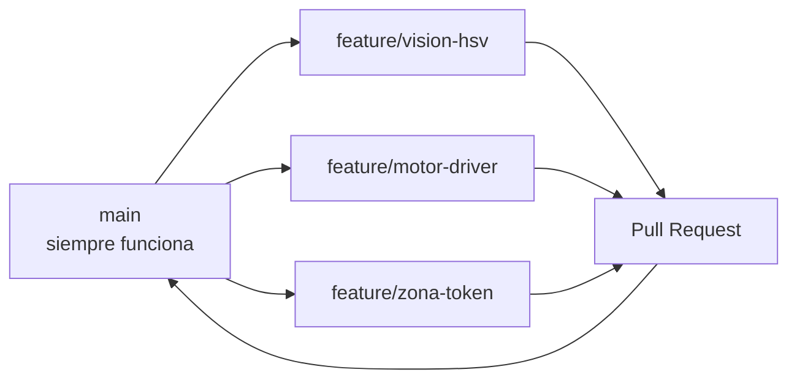

# Sistema Multirobot — Tecnología, Código y To-Do de Laboratorio

> Copia exportada el 13-10-2026 del documento vivo del equipo. Si hay diferencias, manda el documento vivo; esta copia se actualiza al cierre de cada semana.

**Robótica · UCAB** · Sep 22, 2026 · @Ignacio

## Qué cubre este documento

El documento inicial dice **qué** tiene que hacer el sistema. Este dice **cómo lo vamos a construir**: con qué lenguajes, con qué herramientas, cómo se organiza el código, y qué hay que hacer cada vez que entremos al laboratorio.

Está pensado para dos momentos distintos:

- **Antes de empezar a programar**, para que los tres equipos usen las mismas herramientas y la misma estructura. Si cada equipo organiza su código a su manera, integrar se vuelve un infierno.
- **Durante cada sesión de laboratorio**, como lista de tareas concreta. La última sección es literalmente qué hacer al llegar.

Dos aclaraciones sobre las recomendaciones que vienen:

Ninguna es un capricho. Cada una intenta responder a la misma pregunta: *¿qué nos deja llegar a una demo que funcione, con doce personas que en su mayoría no han usado esto antes, en unas diez semanas?* A veces eso significa elegir la herramienta menos elegante.

Y algunas se pueden cambiar. Las que son difíciles de deshacer más adelante están marcadas como tales.

## Cambio de enfoque del 13 de octubre

Este documento se reescribió en parte el 13 de octubre de 2026. Las decisiones que cambiaron, y por qué:

| Antes | Ahora | Por qué |
| --- | --- | --- |
| Ubuntu Server 24.04 en las Raspberry | **Raspberry Pi OS (Raspbian) de 64 bits** | Ya estaba instalado y configurado. Para lo que necesitamos (Pololu, cámara, GPIO) funciona igual o mejor que Ubuntu |
| ROS 2 Jazzy como middleware | **Sin ROS 2.** Python puro y MQTT para que los robots se hablen | ROS 2 no tiene paquetes oficiales para Raspbian (solo compilando o con Docker). Para el brazo no hace falta, y MQTT cubre la coordinación con mucha menos curva |
| Seis colores de cubo | **Dos colores: azul y amarillo** | Simplificación acordada por el grupo |
| Cada robot móvil con su contenedor | **Una zona azul compartida y dos contenedores junto al brazo** | Phineas lleva los azules y Ferb los amarillos a la zona; Perry los clasifica: amarillo al contenedor amarillo, azul al contenedor verde |
| Posiciones memorizadas para el brazo, cinemática inversa como extra | **Cinemática inversa geométrica desde el inicio** | La tesis de Lugo (2023) la resuelve para el mismo modelo de brazo y la misma controladora |
| C++ en el repositorio actual | **Python** | Decisión del grupo, coherente con el resto del documento |

Lo que **no** cambió: Python, OpenCV con la vía HSV primero, un solo repositorio, configuración en YAML y las reglas de trabajo en equipo.

Las secciones que hablaban de ROS 2, Docker o Ubuntu se reescribieron. Donde quede alguna mención suelta, vale lo de esta tabla.

## Lenguajes de programación

**Python para todo, salvo que se demuestre que no alcanza.**

Sin ROS 2, cada robot corre un programa en Python y los tres se comunican por MQTT. No hay una segunda opción de lenguaje que mantener.

| Lenguaje | Dónde lo usamos | Por qué |
| --- | --- | --- |
| Python | Todo: máquinas de estado, visión, control del brazo, coordinación | Se escribe rápido, se lee fácil, se depura sin recompilar. La mayoría del grupo ya lo conoce |
| C++ | No se usa. El código C++ que había en el repositorio se reemplaza | Cuesta el triple de tiempo escribirlo y depurarlo, y nada del sistema lo necesita |
| Bash | Scripts de instalación y respaldo de las SD | Son cuatro líneas y ahorran errores manuales |
| YAML | Configuración: medidas del brazo, límites de los servos, rangos de color, posiciones de los contenedores | Se cambia un valor sin tocar código |

### Por qué Python y no C++

La objeción obvia: Python es más lento. Es cierto, y aquí no importa.

Lo que hace nuestro sistema son decisiones a unas pocas veces por segundo: ¿hay un cubo delante?, ¿pido la llave?, ¿a qué contenedor va este cubo? Eso no exige rendimiento. Lo único pesado es el procesamiento de imágenes, y ahí las librerías de Python (OpenCV, NumPy) están escritas en C++ por dentro: Python solo las manda a trabajar.

La parte que sí importa: con doce personas aprendiendo a la vez, el cuello de botella no va a ser la CPU de la Raspberry, va a ser cuánto tardamos en encontrar por qué algo no funciona. En Python se cambia una línea y se vuelve a lanzar. En C++ hay que recompilar y ya perdiste el hilo.

### Regla de estilo

Solo dos cosas, y se cumplen desde el primer día:

- **Todo en inglés en el código** (nombres de variables, funciones, ficheros, tópicos MQTT), **comentarios en español**. Mezclar idiomas dentro de los nombres es lo que produce cosas como `get_posicion_cubo()`.
- **Ningún número suelto dentro del código.** Ni velocidades, ni umbrales, ni ángulos, ni rangos de color. Todo eso vive en archivos YAML. El día de la demo vas a querer ajustar un umbral en treinta segundos, no buscarlo entre quinientas líneas.

## El stack, capa por capa

| Capa | Elegimos | Por qué |
| --- | --- | --- |
| Sistema operativo | Raspberry Pi OS (Raspbian) de 64 bits | Es el sistema oficial de la Pi y ya está configurado. Comprobar 64 bits con `uname -m` (debe decir `aarch64`) |
| Lenguaje | Python 3 | Ver la sección anterior |
| Comunicación entre robots | MQTT: servidor `mosquitto` en una Pi, librería `paho-mqtt` | Cada robot publica mensajes cortos («zona libre», «cubo entregado»). Se aprende en una tarde y no hay que compilar nada |
| Servos del brazo | Pololu Mini Maestro 12 por USB, con `pyserial` | En Linux aparece sola como puerto serie (`/dev/ttyACM0`). No hace falta instalar drivers en la Pi |
| Configuración inicial de la Maestro | Maestro Control Center, una sola vez, desde cualquier PC | Modo serie y límites de cada canal. Queda guardado en la placa |
| Visión | OpenCV | HSV, sustracción de fondo, conversión de píxeles a centímetros y orientación del cubo |
| Cálculo numérico | NumPy | Va debajo de OpenCV y se usa para la cinemática |
| Cámara | Webcam USB con OpenCV (v4l2) | Más simple que la cámara oficial |
| GPIO de la Pi 5 | lgpio o gpiozero | RPi.GPIO no funciona en Pi 5 |
| Configuración | Archivos YAML | Ajustar sin tocar código |
| Control de versiones | Git + GitHub | Ver la sección de repositorios |
| Editor | VS Code + Remote SSH | Editar el código que vive en la Raspberry desde tu laptop |

### Lo que NO metemos en el stack

Cada herramienta que se añade es algo más que puede fallar y que hay que aprender. Estas quedan fuera a propósito:

| Herramienta | Por qué no |
| --- | --- |
| ROS 2 | Sin paquetes oficiales para Raspbian, y para tres robots que intercambian unos pocos mensajes MQTT basta. Si el profesor lo exige, se instala Ubuntu Server 24.04 en las Pi (no Docker) |
| Docker | Pasar al contenedor el puerto de la Maestro y la cámara añade una capa más donde algo se rompe, y depurar se vuelve adivinar |
| MoveIt | Depende de ROS 2, necesita un modelo completo del brazo y semanas de configuración. Bajar en vertical sobre un cubo se resuelve con la cinemática geométrica de la tesis de Lugo |
| Nav2 y SLAM | Necesitan odometría fiable y un mapa. La pista es fija y conocida |
| Gazebo | Pesado de montar. Para probar sin hardware basta con un programa que publique los mismos mensajes MQTT |

Esta lista no es pereza: es reconocer que el tiempo del proyecto se gasta una sola vez.

Si algún equipo termina pronto y quiere meter una de estas, perfecto, pero **como añadido sobre algo que ya funciona**, nunca como el camino principal.

## Cómo organizamos el código

**Un solo repositorio para todo el proyecto.**

> Esto **corrige** lo que decía el documento inicial, donde se proponían cinco repositorios separados. Al pensarlo con más cuidado, para un equipo de estudiantes un repositorio único es claramente mejor, y las razones están abajo.

|  | Un repositorio | Cinco repositorios |
| --- | --- | --- |
| Empezar a trabajar | Un `git clone` y ya | Cinco clones, y hay que saber cuáles |
| Cambiar un mensaje compartido | Un solo commit lo cambia todo a la vez | Hay que coordinar cinco repos y sus versiones |
| Versiones descuadradas | Imposible | El problema clásico: tu robot usa mensajes viejos |
| Ver quién cambió qué | Un historial | Cinco historiales que hay que cruzar |
| Desventaja | Todos ven todo el código | — |

La única desventaja real del repositorio único es que todo el mundo ve todo el código. En una empresa con cien personas eso importa. Aquí, con doce que además tienen que integrar entre sí, es una ventaja.

### Árbol de carpetas

El repositorio del grupo es `Robot_Claw`. Esta es la estructura a la que hay que llevarlo:

```
Robot_Claw/
├─ README.md                Qué es esto y cómo se arranca
├─ requirements.txt         pyserial, opencv-python, numpy, paho-mqtt, pyyaml
├─ docs/
│  ├─ mensajes.md           El contrato: tópicos MQTT y qué lleva cada mensaje
│  └─ bitacora/             Una nota por sesión de laboratorio
├─ scripts/
│  ├─ setup_pi.sh           Deja una Raspberry lista desde cero
│  └─ backup_sd.sh          Respaldo de la tarjeta
├─ common/                  Código compartido por los tres robots
│  ├─ messages.py           Nombres de tópicos y formato de los mensajes
│  └─ mqtt_client.py        Conexión MQTT con reconexión automática
├─ mobile/                  Phineas y Ferb (el mismo código para los dos)
│  ├─ motor_driver.py       Habla con el HAT y mueve las ruedas
│  ├─ edge_detector.py      Detecta el borde negro de la pista
│  ├─ behavior.py           Máquina de estados: buscar, recoger, entregar
│  └─ config/               phineas.yaml (azul), ferb.yaml (amarillo)
├─ perry/                   El brazo
│  ├─ maestro.py            Habla con la Pololu por pyserial
│  ├─ kinematics.py         Cinemática inversa (tesis de Lugo)
│  ├─ vision.py             Detecta el cubo en la zona azul y su color
│  ├─ sorter.py             Ciclo completo: ver, tomar, soltar en su contenedor
│  └─ config/
│     ├─ arm.yaml           Medidas, canales y límites de cada servo
│     ├─ poses.yaml         Inicio, contenedor amarillo, contenedor verde
│     └─ vision.yaml        Rangos HSV y esquinas de la zona
├─ fakes/                   Simuladores de mensajes para probar sin hardware
│  └─ fake_mobile.py
└─ tools/
   ├─ hsv_tuner.py          Deslizadores para ajustar los colores
   ├─ servo_jog.py          Mover un servo a mano para calibrar
   └─ pose_recorder.py      Grabar posiciones del brazo
```

Lo que hay hoy en `prueba/` (un ejecutable de PC, un `CMakeLists.txt` que busca un archivo que no existe y una detección con YOLO en C++) se retira. El ejecutable no corre en la Raspberry y los binarios no van en Git.

### Las tres carpetas que más van a importar

**`common/messages.py`** es el contrato. Un cambio ahí afecta a los tres robots, así que pasa por el integrador. Es el archivo más pequeño del proyecto y el más importante.

**`fakes/`** es lo que permite que ocho personas trabajen mientras cuatro arman chasis. Un simulador publica exactamente los mismos mensajes MQTT que un robot real. El equipo de Perry puede probar todo su ciclo contra un Phineas que no existe.

**`tools/`** parece accesorio y no lo es. El día de la demo la luz del laboratorio no va a ser la de las pruebas, y vas a tener cinco minutos para recalibrar los colores.

### Un detalle que ahorra problemas

Los dos robots móviles comparten **el mismo código**, no uno cada uno. Lo único que los diferencia son sus archivos de configuración: `phineas.yaml` y `ferb.yaml` (su nombre, su zona de búsqueda, su prioridad, la calibración de sus sensores). Así un arreglo beneficia a los dos y no hay que acordarse de copiarlo.

## Convenciones para no pisarnos

Doce personas en un repositorio necesitan reglas. Estas son las mínimas que funcionan sin volverse burocracia.

### Ramas



- **`main` siempre funciona.** Si alguien clona `main` y lo lanza, arranca. Nunca se trabaja directo sobre `main`.
- Cada tarea, su rama: `feature/vision-hsv`, `fix/servo-jitter`, `docs/interfaces`.
- Para volver a `main` hace falta un **Pull Request** revisado por alguien de otro equipo. La revisión no es para buscar errores, es para que **al menos dos personas entiendan cada parte del sistema**. La víspera de la entrega alguien se enferma, y hay que poder continuar.

### Mensajes de commit

Formato simple: `area: qué hiciste`.

```
vision: ajustar rangos HSV para luz de tarde
mobile: frenar cuando el ultrasonido ve menos de 15 cm
arm: grabar poses de deposito en contenedor oscuro
docs: actualizar contrato de topicos
```

Nada de `cambios`, `arreglo`, `update`, `asdf`. Dentro de dos meses vas a buscar cuándo se rompió algo, y el historial es lo único que tienes.

### Nombres

| Cosa | Convención | Ejemplo |
| --- | --- | --- |
| Carpeta o módulo | minúsculas con guion bajo | `edge_detector.py` |
| Función | verbo, en inglés | `pick_cube()`, no `funcion1()` |
| Tópico MQTT | `robot/cosa` | `perry/zona`, `phineas/estado` |
| Mensaje | JSON corto, campos en inglés | `{"color": "blue", "from": "phineas"}` |
| Variable | minúsculas con guion bajo, en inglés | `cube_position` |
| Rama | tipo/descripcion-corta | `feature/hsv-tuner` |

### Cómo se reparte el trabajo

Un tablero de tareas con cuatro columnas: **Por hacer · En curso · En revisión · Hecho**. Tres reglas:

1. **Una tarea tiene un solo responsable.** Si son dos, no es de nadie.
2. **Nadie tiene más de dos tareas en curso.** Si hay cinco abiertas, no hay ninguna avanzando.
3. **Toda tarea nombra su criterio de aceptación**, normalmente el de un requisito del documento inicial. “Mejorar la visión” no es una tarea. “RF-10: 19 de 20 cubos bien clasificados” sí lo es.

### La regla del final del día

Antes de irse del laboratorio, **todo el mundo sube lo que hizo**, aunque esté a medias y no funcione. Una rama a medio terminar en el repositorio es recuperable. En el disco de alguien que mañana no viene, no.

Esto es también la protección del RNF-07 del documento inicial, y el único antidoto contra el escenario más tonto y más frecuente: la semana perdida porque el código estaba en una laptop que se dañó.

## Visión artificial: HSV, YOLO, o las dos

Hay dos problemas distintos que solemos meter en el mismo saco:

1. **¿Dónde hay un cubo?** (detección)
2. **¿De qué color es este cubo?** (clasificación)

Son problemas con dificultades muy distintas, y lo importante es que **la mejor herramienta para cada uno no es la misma**.

### Nuestro caso concreto: dos colores sobre un fondo azul

Con el cambio de enfoque la visión de Perry se simplifica mucho: solo mira la zona azul de 16,5 × 13,5 cm y solo distingue **azul** y **amarillo**. Pero hay una trampa: **el cubo azul está sobre un fondo azul turquesa**. Si se busca «lo azul» con HSV, el fondo entero responde.

La solución es separar los dos problemas de arriba:

1. **Dónde hay un cubo: sustracción de fondo.** Al arrancar se toma una foto de la zona vacía. En cada ciclo se compara la imagen actual con esa referencia y lo que cambió es el cubo, sea del color que sea.
2. **De qué color es: HSV sobre el recorte del cubo.** Ya sin fondo, azul y amarillo están en extremos opuestos del círculo de tonos y no se confunden.

Tres detalles prácticos:

- La cámara está a 70 cm. Con una webcam típica la zona ocupa unos 130 × 105 píxeles a 640 × 480. Conviene capturar a 1280 × 720 y recortar solo la zona.
- La cámara solo debe mirar la zona azul, no los contenedores (uno es amarillo y el otro verde).
- La foto de referencia se repite si cambia la luz: es un botón en `hsv_tuner.py`.

### Las dos vías

|  | HSV clásico (OpenCV) | YOLO (red neuronal) |
| --- | --- | --- |
| Cómo funciona | Filtra píxeles por rango de color y busca manchas | Aprende de ejemplos qué aspecto tiene un cubo |
| Preparación | Minutos con una herramienta de deslizadores | Fotografiar, etiquetar y entrenar: días |
| Velocidad en Pi 5 | Cientos de imágenes por segundo | \~15 imágenes por segundo con NCNN |
| Aguanta cambios de luz | Mal. Hay que recalibrar | Bien, si el conjunto de entrenamiento tiene variedad |
| Aguanta sombras y reflejos | Mal | Bien |
| Distingue un cubo de una mano | No | Sí |
| Se depura fácil | Sí: se ve la máscara y se entiende qué pasó | No: falla y no sabes por qué |
| Si falla el día de la demo | Mueves un deslizador | No hay nada que mover |

Sobre la velocidad, para quitar el miedo: un modelo YOLO nano en una Raspberry Pi 5, exportado al formato NCNN, tarda unos **67 milisegundos por imagen** a 640 píxeles. Eso son unas 15 imágenes por segundo. Nuestro sistema necesita reconocer un cubo quieto sobre una mesa, no seguir un carro en movimiento. **Con 2 imágenes por segundo nos sobra.** El rendimiento no es un argumento en contra de YOLO aquí.

El argumento real en contra es otro: **YOLO necesita datos**, y conseguirlos cuesta días que no tenemos garantizados.

### Lo que proponemos: las dos, en este orden

**Fase 1 — HSV puro, y que funcione.** Detección y clasificación con OpenCV. Esto tiene que estar operativo y cumplir los requisitos. Es la red de seguridad: pase lo que pase, hay un sistema que funciona.

**Fase 2 — YOLO para detectar, HSV para el color.** Si la fase 1 está lista y sobra tiempo, se añade un modelo YOLO entrenado con **una sola clase: “cubo”**. YOLO dice dónde hay cubos, se recorta cada uno, y el color se decide con HSV sobre ese recorte.

Esta división no es un apaño, es la arquitectura correcta:

- YOLO es bueno reconociendo **formas** y muy tolerante a sombras y reflejos, que es justo donde HSV sufre.
- HSV es infalible decidiendo si un recorte limpio de 40×40 píxeles es rojo o vinotinto, y **no requiere reentrenar nada** si el profesor cambia la regla de clasificación.
- Entrenar una sola clase necesita **muchos menos datos** que entrenar seis. Con 200–300 imágenes basta.
- Y lo mejor: se puede cambiar de una vía a la otra **sin tocar el resto del sistema**, porque las dos publican exactamente el mismo mensaje.

### El truco para el conjunto de datos

Etiquetar 300 imágenes a mano son varias tardes muertas. Hay un atajo que se aprovecha de que ya tendremos HSV funcionando:

1. Se graba un video moviendo los cubos por la pista, cambiando la luz, tapando alguno, poniendo la mano encima. 10 minutos de video.
2. Se pasa el detector HSV por todos los fotogramas y **se guardan sus detecciones como etiquetas automáticas**.
3. Una persona revisa rápido y corrige lo que HSV se comió o inventó. Corregir es muchísimo más rápido que etiquetar desde cero.
4. Se entrena con eso.

El resultado es un modelo que aprende justo los casos donde HSV falla, porque son los que la persona tuvo que corregir. Convertir dos tardes de trabajo en dos horas.

### Hugging Face y Ultralytics: qué sirve de cada uno

| Para qué | Dónde |
| --- | --- |
| Entrenar y exportar el modelo | **Ultralytics**. Tres líneas de Python para entrenar, una para exportar a NCNN |
| Modelos de partida ya entrenados | **Hugging Face Hub** y el propio Ultralytics. Se parte de uno general y se reentrena con nuestras imágenes |
| Entrenar sin GPU propia | **Google Colab**, gratis. **Nunca entrenar en la Raspberry**: tardaría días |
| Guardar el modelo y el dataset del grupo | **Hugging Face Hub**, con la cuenta del proyecto |
| Etiquetar a mano lo que falte | **Roboflow** o **CVAT**, los dos gratis para este tamaño |

Detalle que vale oro el día de la presentación: **exportar el modelo a NCNN** antes de llevarlo a la Raspberry. Es una sola línea y multiplica la velocidad por cuatro frente a ejecutarlo tal cual sale del entrenamiento.

### El límite que hay que respetar

YOLO es la parte vistosa del proyecto y por eso es peligrosa: es tentadora para el equipo de visión, se lleva semanas, y el jurado evalúa que los robots hagan su trabajo, no que la red sea bonita.

**Regla dura:** nadie toca YOLO hasta que la vía HSV cumpla los requisitos de visión del documento inicial. Si llegamos a la semana 8 y HSV todavía no está fino, YOLO se cancela sin discusión.

## Perry: escenario, cinemática y Pololu

### El escenario

1. Phineas recoge los cubos **azules** y Ferb los **amarillos**, repartidos por la pista.
2. Cada uno deja su cubo en la **zona azul** frente al brazo: Phineas en la mitad izquierda y Ferb en la derecha, para que dos cubos no queden pegados.
3. Perry ve el cubo, lo toma y lo suelta: **amarillo en el contenedor amarillo, azul en el contenedor verde**.

Medidas tomadas por el grupo (a confirmar con calibrador):

| Medida | Valor |
| --- | --- |
| Zona de recolección | 16,5 × 13,5 cm |
| Robot respecto del borde de la pista | a 6 cm |
| Borde de la pista al área | 21,2 cm |
| Base del brazo | 10 cm de diámetro, 4,5 cm de alto |
| Eslabones (hombro→codo, codo→muñeca, muñeca, pinza) | 12, 16, 6 y 6 cm |
| Altura de la cámara | 70 cm |

### Cómo se calculan los ángulos

Se usa el **método geométrico** de la tesis de Lugo (2023, capítulo IV). Su idea clave es una restricción: **la pinza baja siempre en vertical**, perpendicular a la mesa. Con eso el último tramo del brazo (muñeca + pinza = 12 cm) queda fijo, y el problema se reduce a un triángulo que se resuelve con trigonometría de bachillerato.

Nombres: E1 = 4,5 cm (altura del hombro), E2 = 12 cm (brazo), E3 = 16 cm (antebrazo), E45 = 12 cm (muñeca + pinza). El origen está en el eje de la base, sobre la mesa. El punto de agarre es (x, y, z), con z ≈ la mitad de la altura del cubo.

**Paso 1 — Base.** La base gira hacia el cubo:

> θ1 = atan2(y, x)

**Paso 2 — Reducir a un plano.** Ya orientada la base, solo importa la distancia horizontal al cubo y la altura de la muñeca respecto del hombro:

> r = √(x² + y²) a = (z + E45) − E1 c = √(r² + a²) — la distancia recta del hombro a la muñeca

Si c es mayor que E2 + E3 (28 cm), el cubo está fuera de alcance.

**Paso 3 — Hombro, codo y muñeca con la ley de cosenos.** El brazo forma un triángulo de lados E2, E3 y c, y un triángulo rectángulo de catetos r y a:

> Hombro: θ2 = atan2(a, r) + acos((c² + E2² − E3²) / (2·c·E2)) Codo (ángulo interior): θ3 = acos((E2² + E3² − c²) / (2·E2·E3)) Muñeca (ángulo interior): θ4 = atan2(r, a) + acos((c² + E3² − E2²) / (2·c·E3))

Comprobación rápida: θ2 + θ3 + θ4 + 90° siempre suma 360°, porque son los ángulos de un cuadrilátero.

**Paso 4 — Giro de la pinza.** Con la imagen se calcula el ángulo del cubo (la tesis usa análisis de componentes principales sobre el contorno; con `cv2.minAreaRect` sale igual). Como el cubo es simétrico cada 90°, se lleva a un valor entre −45° y 45° y se le resta θ1, porque la base ya giró:

> θ5 = ángulo\_del\_cubo − θ1 (reducido a ±45°)

**Paso 5 — De grados a pulsos.** La Maestro no recibe grados sino un ancho de pulso en microsegundos. Para cada servo se miden dos puntos (un ángulo y su pulso, por ejemplo 0° y 90°) y se interpola en línea recta, como en la tabla 2 de la tesis:

> pulso = pulso\_min + (ángulo − ángulo\_min) · (pulso\_max − pulso\_min) / (ángulo\_max − ángulo\_min)

Esa calibración también absorbe la diferencia entre el ángulo geométrico y el cero de cada servo, y el sentido de giro. Se hace una vez por servo con `tools/servo_jog.py` y se guarda en `arm.yaml`.

### En código

```python
from math import atan2, acos, hypot, degrees

E1, E2, E3, E45 = 4.5, 12.0, 16.0, 12.0   # cm, desde arm.yaml

def inverse_kinematics(x, y, z):
    t1 = atan2(y, x)                              # base
    r = hypot(x, y)
    a = (z + E45) - E1
    c = hypot(r, a)
    if not abs(E3 - E2) <= c <= E2 + E3:
        raise ValueError("fuera de alcance")
    t2 = atan2(a, r) + acos((c*c + E2*E2 - E3*E3) / (2*c*E2))   # hombro
    t3 = acos((E2*E2 + E3*E3 - c*c) / (2*E2*E3))                # codo
    t4 = atan2(r, a) + acos((c*c + E3*E3 - E2*E2) / (2*c*E3))   # muñeca
    return [degrees(t) for t in (t1, t2, t3, t4)]
```

Se verificó calculando el camino inverso (cinemática directa): con estos ángulos la punta de la pinza cae exactamente en el punto pedido y apunta a −90°.

### Ejemplo y alcance con nuestras medidas

Agarre a 1,5 cm de altura (cubo de unos 3 cm):

| Cubo en | Base | Hombro | Codo | Muñeca |
| --- | --- | --- | --- | --- |
| 15,2 cm al frente (borde cercano, estimado) | 0° | 92,5° | 76,8° | 100,8° |
| 22 cm al frente (centro, estimado) | 0° | 59,7° | 115,4° | 94,9° |
| 26 cm al frente | 0° | 31,5° | 158,4° | 80,2° |
| 22 cm al frente y 8 cm a la izquierda | 20° | 51,8° | 126,6° | 91,6° |

Dos conclusiones que hay que verificar en el laboratorio:

- **Borde lejano:** con la pinza vertical el alcance máximo es de unos **26,5 cm**. Si el borde lejano de la zona queda a \~29 cm, esa franja no se alcanza. Salidas: acercar el robot unos 3 cm, o permitir que la pinza baje algo inclinada solo en esa franja.
- **Borde cercano:** ahí el hombro pasa de 90° (se inclina hacia atrás). En la tesis el hombro iba de 15° a 90°. Hay que medir el límite real de nuestro servo.

Antes de cualquier ajuste: medir con calibrador la distancia del **eje de la base** al borde cercano y al lejano de la zona, y la altura real del eje del hombro.

### La Pololu desde la Raspberry

Configuración de una sola vez, desde Maestro Control Center en cualquier PC:

- **Serial mode: USB Dual Port.**
- **Límites de cada canal.** Por defecto la Maestro recorta cada canal a 992–2000 µs, y la base, por ejemplo, necesita de \~500 a \~2500. Sin este paso el brazo «no llega» aunque el cálculo esté bien.
- **Velocidad y aceleración** moderadas, para que el brazo no dé tirones.

Canales según la tesis (verificar el cableado real): base 0, hombro 2, codo 4, muñeca 6, giro de muñeca 8, pinza 10.

En la Pi no se instala ningún driver:

```bash
ls /dev/ttyACM*                   # dos puertos; el de comandos es el primero
sudo usermod -aG dialout $USER    # cerrar sesión y volver a entrar
pip install pyserial
```

```python
import serial

maestro = serial.Serial("/dev/ttyACM0", timeout=1)

def set_target(channel, microseconds):
    t = int(microseconds * 4)          # la Maestro trabaja en cuartos de microsegundo
    maestro.write(bytes([0x84, channel, t & 0x7F, (t >> 7) & 0x7F]))
```

### El ciclo de Perry

1. Posición de inicio, fuera del campo de la cámara.
2. Detectar el cubo, su color y su ángulo.
3. Calcular ángulos y pulsos. Girar la base y la muñeca, bajar, cerrar la pinza.
4. **Subir por encima del borde de los contenedores** (miden unos 5–6 cm) antes de girar.
5. Ir a la posición grabada del contenedor que toca y abrir la pinza.
6. Volver al inicio y avisar por MQTT que la zona está libre.

Los contenedores están en posiciones fijas, uno a cada lado del brazo, así que para soltar no hace falta cinemática: son dos posiciones grabadas en `poses.yaml`.

### Turnos en la zona (MQTT)

Si un robot suelta un cubo mientras el brazo está bajando, chocan. La regla:

| Quién | Publica en | Cuándo |
| --- | --- | --- |
| Phineas o Ferb | `perry/pedir_zona` | Al llegar frente a la zona. No entra hasta recibir permiso |
| Perry | `perry/zona` = `libre` u `ocupada` | Responde y avisa cada vez que cambia |
| Phineas o Ferb | `perry/cubo_entregado` | Al salir de la zona, con su color |
| Perry | `perry/zona` = `libre` | Cuando el cubo ya está en el contenedor y el brazo volvió al inicio |

## Repositorios a forkear y consultar

Bifurcar (*fork*) un repositorio significa hacer una copia propia que podemos modificar sin perder el rastro del original. Aquí conviene hacerlo con dos, porque vamos a tener que adaptarlos.

### El hallazgo importante: la tesis del hermano de un compañero

[GloodBuster/Tesis-Brazo-Robotico](https://github.com/GloodBuster/Tesis-Brazo-Robotico) es un trabajo de grado que clasifica residuos con un brazo robótico y visión artificial. **Usa la misma controladora Pololu Maestro que nosotros**, y eso lo convierte en la referencia más útil que tenemos.

Lo revisamos a fondo. Esto es lo que hay dentro:

| Qué contiene | Nos sirve |
| --- | --- |
| `Robot_Movement/control_brazo.cpp` | Comunicación con la Maestro por puerto serie a 115200 baudios, convirtiendo microsegundos a las unidades de la placa (×4) |
| `Robot_Movement/our_lugo_solution.py` | **Cinemática inversa completa y funcionando** para un brazo de 5 articulaciones: `atan2` para la base y ley de cosenos para hombro y codo |
| `Robot_Movement/angles.py` | Tabla de calibración por articulación: ángulo mínimo y máximo, pulso mínimo y máximo, y compensación de gravedad para el hombro |
| `Robot_Movement/containers_movement.py` | Movimiento hacia contenedores según la clasificación. Es literalmente nuestro caso de uso |
| `Model/` | Clasificación con Keras y TensorFlow, modelo entrenado en Teachable Machine, 6 clases de material |
| `Model/plano_cartesiano.py` | Conversión de píxeles a coordenadas del plano |

#### Lo que resuelve de golpe

**Aquel asunto de “la librería está orientada a Windows” que mencionó el profesor: es exactamente esto.** El archivo `control_brazo.cpp` usa `windows.h` y `CreateFileA`, se compila a un `.exe`, y Python lo invoca como un subproceso externo. En Linux no funciona.

La buena noticia es que ahora sabemos con precisión qué hay que portar, y es poco: **el protocolo completo está a la vista en ese archivo**. Pasarlo a Python con `pyserial` sobre `/dev/ttyACM0` son unas veinte líneas. Lo que era una incógnita de la primera sesión pasa a ser una tarea de una tarde.

**Actualización del 13 de octubre:** la cinemática inversa ya no es un extra. La tesis original de Lugo, en la que se basa este repositorio, explica el método completo para nuestro mismo modelo de brazo (ver la sección *Perry: escenario, cinemática y Pololu*). Las posiciones memorizadas se mantienen solo para lo que es fijo: inicio y los dos contenedores.

#### Lo que NO hay que copiar

Es código de tesis, con lo que eso implica. Tres advertencias concretas:

1. **Los números son de su brazo, no del nuestro.** Las longitudes de eslabón (6, 10, 12, 5 y 6 cm), los límites de ángulo y los pulsos de cada servo hay que volver a medirlos. Lo reutilizable es **la estructura**, no los valores.
2. **Hay números mágicos incrustados.** En `control_robot.py` aparecen ajustes sueltos y un valor que se sobreescribe a mano pisando lo que calculó la cinemática. Son parches de última hora antes de una defensa. Entenderlos sí, arrastrarlos no.
3. **Su vía de visión no encaja con la nuestra.** Usan TensorFlow con un modelo de Teachable Machine, que en una Raspberry Pi 5 es pesado, y clasifican material (cartón, vidrio, metal), no color. Nuestro plan de HSV y YOLO exportado a NCNN sigue siendo el adecuado. Y su conversión de píxeles a centímetros es una escala lineal simple, que solo funciona con la cámara perfectamente perpendicular: **nuestra homografía de cuatro puntos es más robusta**.

#### Dos cosas que hay que hacer

- **Pedir permiso por escrito.** El repositorio no tiene licencia, lo que legalmente significa que todos los derechos son del autor. Siendo el hermano de un compañero es trámite, pero conviene tenerlo dicho y citar el trabajo en nuestra documentación. Es integridad académica, no formalismo.
- **Conseguir media hora con él.** Vale más que leer el código entero: cómo alimentó los servos, qué se le rompió, y qué haría distinto. Eso no está en ningún repositorio.

### Para forkear (los vamos a modificar)

| Repositorio | Qué es | Qué hay que adaptar |
| --- | --- | --- |
| GloodBuster/Tesis-Brazo-Robotico | Tesis de brazo clasificador con la misma controladora Maestro | Tomar la estructura de la cinemática y de los movimientos a contenedores. Remedir las longitudes del brazo |
| Cokoino/CKK0018 | Código de ejemplo del HAT de motores que tenemos | Casi seguro hay que portarlo a Pi 5: cambiar RPi.GPIO por lgpio |
| FRC4564/Maestro | Librería Python para la controladora Pololu Maestro | Usarla directamente desde `perry/maestro.py`. Ya habla el protocolo desde Linux |

### Para consultar (no los modificamos, aprendemos de ellos)

| Recurso | Para qué nos sirve |
| --- | --- |
| **Tesis de Miguel Lugo (UCAB, 2023), tutor Jesús Lárez** | La referencia principal de Perry. Mismo modelo de brazo de 5 grados de libertad y misma Mini Maestro 12. Trae la cinemática geométrica, los límites de cada servo (tabla 2), los canales (anexo A), la visión por color con orientación del objeto y la descarga en dos cajas a los lados. Sus medidas son de su brazo: las nuestras hay que medirlas |
| Tesis de Saad (2015) | Entorno de programación original de este mismo brazo. De ahí sale el diagrama de conexiones que reproduce Lugo |
| papabricole/Pololu-Maestro | Segunda librería del Maestro, multiplataforma. Útil si la otra da problemas |
| Guía del usuario de la Pololu Maestro | Modos serie, protocolo de comandos y configuración en Linux |
| Documentación de paho-mqtt y mosquitto | Comunicación entre los tres robots |
| Documentación de lgpio / gpiozero | La forma correcta de usar los pines en Pi 5 |

### Cómo se integra un fork

No se copian archivos sueltos dentro de nuestro repositorio. Se instala como dependencia normal de Python, apuntando a nuestro fork. Así queda claro qué código es nuestro y qué código es prestado, que es exactamente lo que hay que poder explicar en la defensa del proyecto.

Y una advertencia sobre el código de ejemplo de los fabricantes: suele estar escrito para que el producto se vea bien en una demo de cinco minutos, no para funcionar de forma continua. Sirve para entender cómo se habla con el hardware. **La lógica del robot la escribimos nosotros.**

## Cómo trabajan doce personas con tres Raspberry

El problema práctico: hay tres robots y doce personas. No todos pueden estar tocando hardware a la vez, y las laptops del grupo serán una mezcla de Windows, macOS y quizá algún Linux. Sin ROS 2 esto se simplifica: Python, OpenCV y MQTT corren igual en cualquiera de ellas.

### Tres formas de trabajar, según lo que toque

| Situación | Cómo | Quién |
| --- | --- | --- |
| Tocar hardware real | VS Code con Remote SSH contra la Raspberry. Editas en tu laptop, el código corre en la Pi | El que tenga el robot ese día |
| Programar lógica sin hardware | Python en tu propia máquina, con `mosquitto` local y los simuladores de `fakes/` | Todos los demás |
| Ajustar la visión | Fotos o video de la zona tomados en el laboratorio, procesados en tu laptop | El equipo de visión |

**VS Code con Remote SSH es la pieza clave** y conviene que todo el mundo la configure el primer día. Te deja abrir la carpeta de la Raspberry como si fuera local: mismo editor, mismo autocompletado, terminal incluida. Sin eso, la gente termina editando con `nano` por SSH y copiando archivos a mano, que es como se pierden horas y se sobrescriben cambios.

### La receta contra “en mi máquina sí funcionaba”

Tres medidas, por orden de importancia:

1. **Un solo script de instalación**, `scripts/setup_pi.sh`, que deja una Raspberry lista desde cero. Cuando alguien instale algo nuevo, lo añade al script en el mismo commit. Si no está en el script, no existe.
2. **Las tres Pi idénticas.** Mismo Raspbian de 64 bits, misma versión de Python, mismas librerías. Una Pi distinta produce fallos que no se reproducen y consumen días.
3. **Nada de instalar cosas «rapidito».** Es lo que rompe el punto 1 y siempre se descubre tarde.

### Acceso a las Raspberry

- **Nombres, no direcciones IP.** `phineas.local`, `ferb.local`, `perry.local`. Las IP cambian y nadie las recuerda.
- **Claves SSH, no contraseñas.** Se configura una vez y ahorra escribir la clave cincuenta veces al día.
- **Un usuario común del proyecto** en las tres, más la clave pública de cada quien.

### Respaldos, que es lo que nadie hace hasta que duele

Cuando una Raspberry quede configurada y funcionando, **se hace una imagen de su tarjeta ese mismo día**. Una microSD corrupta por una caída de tensión es de las cosas más probables de este proyecto — está en la tabla de riesgos del documento inicial — y la diferencia entre perder veinte minutos y perder una semana es tener esa imagen.

El respaldo se guarda en dos sitios distintos, no solo en la laptop de una persona.

## Qué hacer en cada sesión de laboratorio

Esta es la parte que se consulta el mismo día. Cada sesión tiene un objetivo único y una prueba que dice si se cumplió.

> **Regla de oro:** llegar con el objetivo decidido. Una sesión que empieza con “a ver qué hacemos” se va entera en decidir.

### Antes de entrar, siempre

- [ ] Todo el mundo hizo `git pull`
- [ ] Está claro quién trabaja en qué
- [ ] Está el responsable de energía (si se va a conectar algo)
- [ ] Alguien tiene el teléfono listo para grabar la evidencia

### Antes de salir, siempre

- [ ] Todo subido al repositorio, aunque esté a medias
- [ ] Nota de la sesión en `docs/bitacora/`: qué se hizo, qué falló, qué queda
- [ ] Baterías desconectadas y material guardado
- [ ] Objetivo de la próxima sesión escrito

---

### Sesión 1 · Medir y verificar

**Objetivo:** tener las medidas reales y el hardware comprobado. Una parte ya está hecha.

- [x] Brazo conectado y Pololu probada desde una PC
- [x] Raspberry configurada con Raspbian
- [ ] Comprobar que el Raspbian es de 64 bits (`uname -m` → `aarch64`)
- [ ] Medir con calibrador los eslabones del brazo y la altura real del eje del hombro
- [ ] Medir la distancia del **eje de la base** al borde cercano y al lejano de la zona azul
- [ ] Medir los contenedores y marcar en la mesa dónde van, uno a cada lado del brazo
- [ ] Verificar en qué canal de la Maestro está cada servo
- [ ] Montar el HAT Cokoino en una Pi y lograr que gire un motor
- [ ] Fotografiar conexiones, etiquetas de las fuentes y el HAT por ambas caras

**Prueba de éxito:** todas las medidas están en `perry/config/arm.yaml` y un motor gira desde una Pi.

---

### Sesión 2 · Perry se mueve desde la Pi

**Objetivo:** controlar cada servo desde Python en la Raspberry.

- [ ] Configurar la Maestro: modo USB Dual Port, límites de cada canal, velocidad y aceleración
- [ ] En la Pi: ver `/dev/ttyACM0`, agregar el usuario a `dialout`, instalar `pyserial`
- [ ] Mover cada servo por separado con `tools/servo_jog.py`, nunca todos a la vez con la fuente de 3 A
- [ ] Anotar para cada articulación el pulso a 0° y a 90° (calibración de grados a pulsos)
- [ ] Grabar las posiciones de inicio, contenedor amarillo y contenedor verde
- [ ] Limpiar el repositorio: retirar `prueba/` y crear la estructura de este documento
- [ ] Imagen de respaldo de la tarjeta de la Pi

**Prueba de éxito:** desde la Pi, el brazo va del inicio a cada contenedor y vuelve, pasando por encima del borde.

---

### Sesión 3 · Perry clasifica

**Objetivo:** el ciclo completo del brazo con cubos puestos a mano.

- [ ] Montar la cámara a 70 cm sobre la zona y capturar a 1280 × 720
- [ ] Marcar las cuatro esquinas de la zona para convertir píxeles a centímetros
- [ ] Tomar la foto de referencia de la zona vacía y probar la detección del cubo
- [ ] Calibrar con `hsv_tuner.py` los rangos de azul y amarillo bajo la luz del laboratorio
- [ ] Probar la cinemática con un cubo en cinco posiciones de la zona y anotar el error
- [ ] Correr el ciclo completo: ver, tomar, soltar en su contenedor

**Prueba de éxito:** de 10 cubos puestos a mano, al menos 9 terminan en el contenedor correcto.

---

### Sesión 4 · Turnos con Phineas y Ferb

**Objetivo:** que los robots móviles y el brazo se coordinen.

- [ ] `mosquitto` instalado en la Pi de Perry y las tres Pi conectadas a la misma red
- [ ] Mensajes de turno en `common/messages.py`
- [ ] Probar Perry contra `fakes/fake_mobile.py` antes de usar un robot real
- [ ] Un robot móvil entrega un cubo en su mitad de la zona por comando

**Prueba de éxito:** un robot pide la zona, entrega su cubo, Perry lo clasifica y libera la zona.

---

### El kit que hay que llevar siempre

Medio maletero de problemas se resuelve teniendo esto a mano:

| Qué | Por qué |
| --- | --- |
| **Multímetro** | Es el único que responde “¿llega corriente o no?”. La mitad de los fallos son eléctricos |
| microSD de repuesto con imagen lista | Una tarjeta corrupta deja de costar la sesión |
| Cables dupont y USB extra | Siempre falta uno, y siempre hay uno malo |
| Destornilladores y llaves Allen | El kit trae unas penésimas |
| Cinta de papel y marcador | Etiquetar cables y marcar posiciones en la pista |
| Baterías cargadas **la noche anterior** | Cargar consume la sesión entera |
| Cargador USB-C de 5 V / 5 A | Para trabajar en mesa sin gastar batería |
| Este documento y el inicial | Para consultar los requisitos sin memoria ni invención |

## Dónde vive cada cosa

Con doce personas el riesgo no es que falte información, es que esté repartida en cinco sitios y nadie sepa cuál está al día. Una regla: **cada tipo de información tiene un solo lugar**.

| Qué | Dónde | Por qué ahí |
| --- | --- | --- |
| Código | **GitHub** | No hay alternativa |
| Tareas | **Tablero de GitHub Projects** o Notion | Si está pegado al repositorio, las tareas se enlazan con los cambios de código |
| Documentos (este y el inicial) | Donde estén ahora, con copia en `docs/` | Se leen y se editan; no son código |
| Bitácora de sesiones | `docs/bitacora/` en el repositorio | Es historia del proyecto y va con el código |
| Conversación rápida | WhatsApp | Es donde ya está el grupo. Pero nada importante vive solo ahí |
| Fotos y videos de evidencia | Carpeta compartida en la nube | Pesan demasiado para el repositorio |
| Modelo y dataset de visión | Hugging Face Hub | También pesan demasiado para Git |

### Sobre WhatsApp

Es donde va a pasar la mayor parte de la comunicación, y eso está bien. El problema es que **lo que se decide ahí se pierde**: a las dos semanas nadie encuentra el mensaje donde se acordó algo.

Regla sencilla: si en el grupo se toma una decisión técnica, alguien la escribe ese mismo día en el documento que corresponda. Sin eso, dentro de un mes se va a discutir de nuevo lo mismo y nadie va a recordar por qué se decidió lo que se decidió.

### Si el proyecto se muda a Notion o a Git

Estos dos documentos están escritos para que se puedan mover: son texto estructurado, sin nada atado a la herramienta. Lo único que hay que cuidar al mudarlos es no dejar dos copias vivas a la vez. Una copia desactualizada es peor que no tener copia, porque alguien la va a leer y le va a creer.

## Fuentes consultadas

- Lugo, M. (2023). *Sistema de clasificación basado en visión por computador con brazo robótico antropomórfico de 5 grados de libertad*. Trabajo de grado, UCAB Guayana. Tutor: Jesús Lárez
- [ROS 2 Jazzy: Installing on Raspberry Pi](https://repo.test.ros2.org/en/jazzy/How-To-Guides/Installing-on-Raspberry-Pi.html) (soporte de Ubuntu y de Raspberry Pi OS)
- [Pololu Maestro: guía del usuario](https://www.pololu.com/docs/0J40) (modos serie, protocolo y uso en Linux)
- Librerías Python para Maestro: FRC4564/Maestro, papabricole/Pololu-Maestro
- Repositorio del HAT Cokoino y modelos de Raspberry Pi que declara soportar
